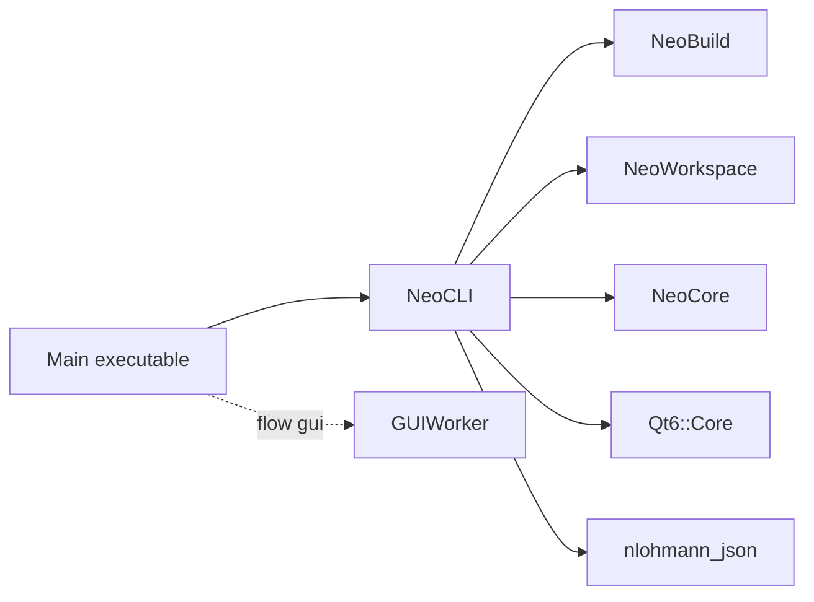

# NeoCLI

## Overview

`NeoCLI` (STATIC) implements the `info` / `exec` / `flow` command groups of the main executable. It parses the command line, dispatches to a handler that drives `NeoWorkspace` and `NeoBuild`, and writes either human-readable output or a machine-readable JSON block. The library holds no window and no build logic: everything it reports comes from the engines, so a CLI build and a GUI build cannot drift apart.

## Goals

- Complete every query and build without a GUI, so servers and CI can run unattended;
- Be machine-readable: `--json` produces a single JSON block on stdout with all human logs on stderr;
- Share the same engines as the GUI instead of reimplementing orchestration;
- Fail with a small, stable exit-code contract (`0` success, `1` runtime failure, `2` usage error).

## Boundaries

**What it does**

- `ArgParser`: recognises the three categories, their verbs, `--key value` / `--key=value` options, `/`-prefixed Windows-style options, help and version tokens;
- `CliDispatcher`: implements `info` (13 verbs), `exec` (9 verbs) and `flow console`, including the git sub-commands and the repo-trust checks;
- `CliOutput`: coloured human output, tables, progress lines, and the `=====JSON-BEGIN=====` / `=====JSON-END=====` block writer.

**What it does not do**

- Does not implement build or export logic - it calls `BuildEngine` / exporter plugins;
- Does not implement GUI pages: `flow gui` is handled by the host executable, which builds a `GUIWorker::WizardWindow` (the `NeoCLI` library therefore does not link `GUIWorker`);
- Holds no repository state: every command re-derives its working directory from `--repo` or the current directory.

## Dependencies

| Dependency | Type | Purpose |
|---|---|---|
| `NeoCore` | STATIC, PUBLIC | `CancelToken`, plugin interfaces, `fsu8` |
| `NeoWorkspace` | STATIC, PUBLIC | workspace model and Git operations used by the `info` verbs |
| `NeoBuild` | STATIC, PUBLIC | build/export engines behind `exec build` and `exec export` |
| `Qt6::Core` | library, PUBLIC | `QCoreApplication` paths, `QProcess` for bundled git |
| `nlohmann_json::nlohmann_json` | header-only, PUBLIC | `info` payloads and the JSON block |

## Files

| File | Purpose |
|---|---|
| `include/arg_parser.h` | `ArgParser`, `CliCategory`, `CliCommand`, verb tables, help/version text |
| `include/cli_dispatcher.h` | `CliDispatcher` and the per-verb handlers (`cmdInfo*`, `cmdBuild`, `cmdExport`, `cmdFlowConsole`, ...) |
| `include/cli_output.h` | `CliOutput` static output helpers and JSON block writer |
| `src/arg_parser.cpp` | token normalisation, category/verb validation, `--help` / `--version` |
| `src/cli_dispatcher.cpp` | command implementations, exit codes, git sub-commands |
| `src/cli_output.cpp` | colour detection, stdout/stderr routing, JSON mode |

## Build integration

- target: `NeoCLI`, library type **STATIC** (`add_library(NeoCLI STATIC src/arg_parser.cpp src/cli_dispatcher.cpp src/cli_output.cpp)`);
- include directory: `modules/NeoCLI/include` (PUBLIC) plus the three engine include roots (PRIVATE);
- links `NeoCore`, `NeoWorkspace`, `NeoBuild`, `Qt6::Core` and `nlohmann_json` **PUBLIC**;
- linked **PRIVATE** into the main executable together with `GUIWorker` and `HiBerGUILibrary`, where `flow gui` is short-circuited before `dispatch` and handed to `runFlowGuiMode`.

## Public symbols

| Symbol | Type | Description |
|---|---|---|
| `ArgParser` | class | `parse`, `printHelp`, `printVersion`, plus the static category/verb/token helpers |
| `CliCategory` | enum class | `None`, `Help`, `Version`, `Info`, `Flow`, `Exec` |
| `CliCommand` | struct | `category`, `verb`, `options`, `positional`, `prefill`, `json`, `verbose`, `silent`, `help`, `error` |
| `CliDispatcher` | class | `dispatch` plus `setGitConfig` / `cancel` / `isCancelled` |
| `CliOutput` | class | `info`/`success`/`warning`/`error`/`progress`/`table`/`title`/`separator`, `jsonBlock`, mode switches |

## Related

- [usage.md](./usage.md)
- [CLI reference](../../../user/cli.md)
