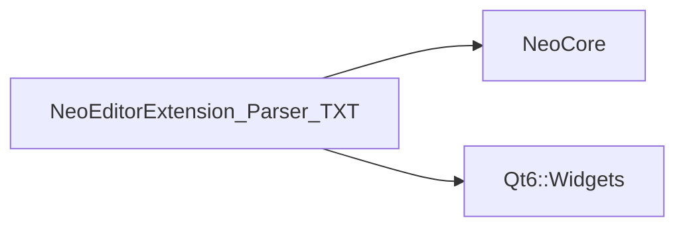

# NeoEditorExtension_Parser_TXT

## Overview

`NeoEditorExtension_Parser_TXT` is an editor extension (SHARED) implementing `NeoCore::IConfigEditorExtension`, providing editing/validation for `.txt` `.properties` `.cfg` text.

## Goals

- Let authors edit safely in the GUI instead of hand-writing JSON;
- Pair with the runtime plugin (merge/resolve);
- Depend only on editor interfaces.

## Boundaries

**Does**: create editor widgets, parse/serialize, validate input.
**Does not**: sync/download (runtime plugins).

## Dependencies

## Files

| File | Purpose |
|---|---|
| `src/` | Implementation and `CreateConfigEditor` |
| `NeoEditorExtension_Parser_TXT.meta.json` | Capability declaration |
| `CMakeLists.txt` | SHARED target |

## Build integration

- target `NeoEditorExtension_Parser_TXT` (SHARED);
- copied to `editor/extension/parsers/`;
- scanned/registered at editor startup.

## Public symbols

| Symbol | Description |
|---|---|
| `CreateConfigEditor` | Factory (`__declspec(dllexport)`) |
| `IConfigEditorExtension` impl | createEditor/... |

## Related

- [usage.md](./usage.md)
- [Editor extensions](../../../extensions/editor/index.md)