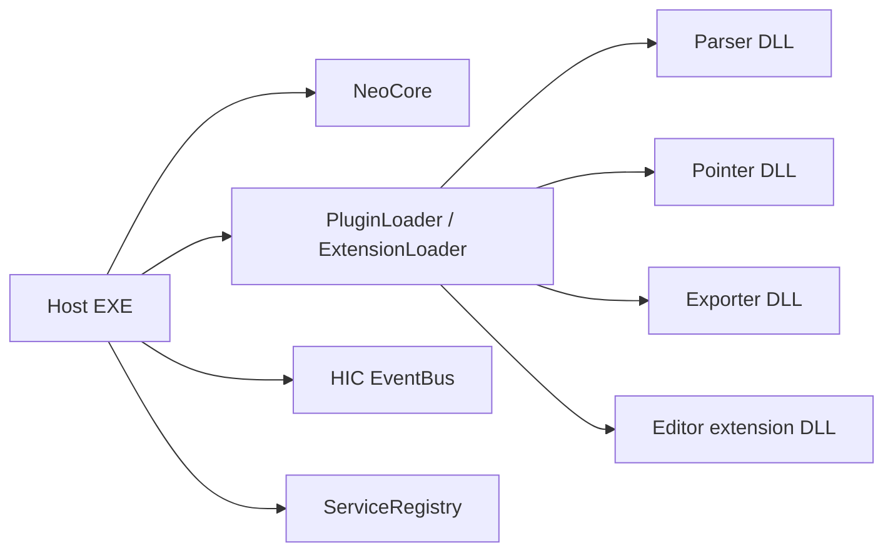

# Framework / Buses / ABI

This group explains how extensions plug in:

1. [Base framework](./base-framework.md): NeoCore interfaces, paths, logging, cancellation, errors;
2. [Module layout](./module-layout.md): target types, dependency direction, artifacts;
3. [Event bus](./event-bus.md): HIC `EventBus`/`ServiceRegistry` APIs and threading;
4. [Extension registry](./extension-registry.md): discovery, loading, registration, lifecycle;
5. [Plugin contracts](./plugin-contracts.md): parser/pointer/exporter/editor-extension contracts;
6. [ABI](./abi.md): exported symbols, cross-DLL boundaries, layout and versioning.

## Relationship

## Principles

- Plugins depend only on NeoCore interface headers;
- Plugins export factories via `extern "C"`;
- The host injects logging (`SetPluginLogSink`); plugins never initialize logging;
- Do not pass STL containers/Qt objects across DLL boundaries unless the ABI explicitly allows it.

## Related

- [Module reference](../Modules/_meta.json)
- [Docs style guide](../../../../_meta/style-guide.md)
