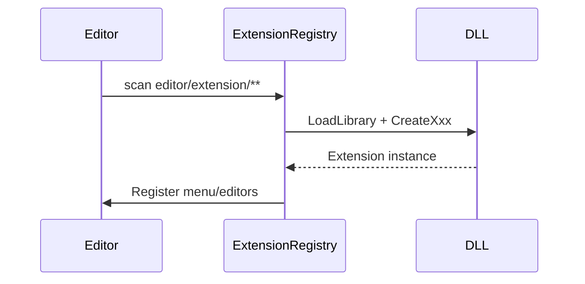

# Editor Extensions

Editor extensions live in `editor/extension/` and come in two kinds:

| Directory | Interface | Extensions |
|---|---|---|
| `editor/extension/parsers/` | `NeoCore::IConfigEditorExtension` | JSON/YAML/TOML/SNBT/TXT/Properties |
| `editor/extension/pointers/` | `NeoCore::IPointerEditorExtension` | DirectURL/Modrinth |

## Loading

- Scanned at startup; DLL + `*.meta.json` must pair;
- `CreateXxx` must be exported;
- Load failures are skipped and logged.

## Menu

The "Extensions" menu groups extensions; selecting one shows its settings/editors.

## Writing an extension

1. Implement `IConfigEditorExtension` or `IPointerEditorExtension`;
2. Export the factory;
3. Provide `*.meta.json` (name/version/dll/extensions);
4. Place it in the right directory and restart the editor.

## Relationship with runtime plugins

Editor extensions use editor interfaces, while runtime plugins implement `IConfigParser`/`IPluginPointer`; they are usually shipped in pairs:

- `NeoParser_JSON.dll` ↔ `NeoEditorExtension_Parser_JSON.dll`;
- `NeoPointer_Modrinth.dll` ↔ `NeoEditorExtension_Pointer_Modrinth.dll`.

## Related

- [Parser extensions](./parser-extensions.md)
- [Pointer extensions](./pointer-extensions.md)
