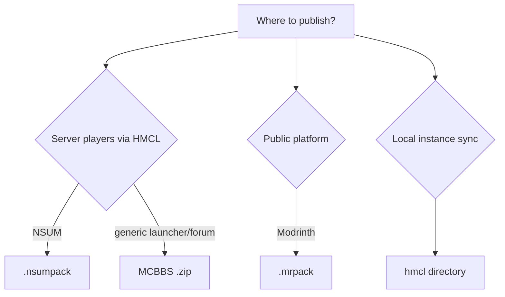

# Exporters

Exporters package builds for distribution. NSUM ships four:

| Exporter | format | Extension | Use |
|---|---|---|---|
| NeoExporter_MCBBS | `mcbbs` | `.zip` | MCBBS / PCL / HMCL universal packs |
| NeoExporter_Modrinth | `modrinth` | `.mrpack` | Modrinth format |
| NeoExporter_HMCL | `hmcl` | (directory) | Sync into an HMCL instance |
| NeoExporter_NSUM | `nsum` | `.nsumpack` | Manifest-only server packs |

## Contract

Implement `NeoCore::IModpackExporter`:

| Method | Purpose |
|---|---|
| `format_name()` | Format name |
| `file_extension()` | Extension |
| `format_description()` | Description |
| `build_modpack()` | Build entry inside the plugin |
| `export_modpack()` | Package the build |

Factory:

```cpp
extern "C" __declspec(dllexport) NeoCore::IModpackExporter* CreateExporter();
```

## Choosing a format



## Related

- [MCBBS](./mcbbs.md) · [Modrinth](./modrinth.md) · [HMCL](./hmcl.md) · [NSUM](./nsum.md)
