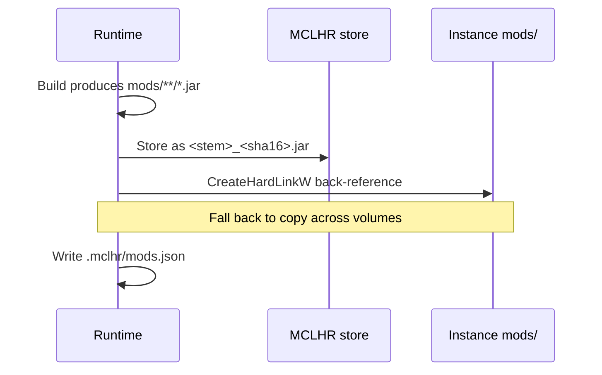

# MCLHR Integration

MCLHR (`mclhr.jar`) maps library coordinates to multiple stores and a launch plan; NSUM uses it after sync to project shared mods into instances.

## Why

- Several instances share the same mods; copying wastes disk;
- Hard links make each jar in `mods/` point to a single store copy;
- Mods are not put on the classpath (avoids loader conflicts).

## Flow



After a successful sync, bridge runs:

```text
java -jar <runtime>/tools/mclhr/mclhr.jar mc mods sync --instance <instance> --mode link --prune
```

## Directories

| Path | Content |
|---|---|
| `<runtime>/tools/mclhr/mclhr.jar` | MCLHR executable jar |
| `<runtime>/stores/mods/` | Content-addressed mod store |
| `<instance>/.mclhr/mods.json` | Projection record |
| `<instance>/mods/` | Hard-link view |

## Notes

- Hard links cannot cross volumes (automatic copy fallback);
- Deleting store files breaks links (use `--prune` to rebuild);
- `--mode link` and `--mode copy` differ; clients default to link;
- If the MCLHR jar is missing, bridge skips it (does not block launch).

## Related

- [Sync and launch](../user/sync-and-launch.md)
- [Server plugin](server-plugin/index.md)
