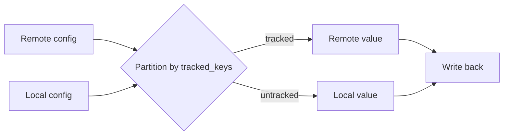

# Config Parsers

Parsers merge configs **semantically** during sync: tracked keys take the server value, player-local keys are preserved.

## Overview

| Parser | Name | Extensions | Modes | Line tracking | Priority |
|---|---|---|---|---|---|
| NeoParser_JSON | JSON | `.json` `.json5` `.jsonc` | full_sync / config_merge / no_sync | No | 100 |
| NeoParser_YAML | YAML | `.yml` `.yaml` | full_sync / config_merge / no_sync | No | 90 |
| NeoParser_TOML | TOML | `.toml` | full_sync / config_merge / no_sync | No | 80 |
| NeoParser_SNBT | SNBT | `.snbt` | full_sync / config_merge / no_sync | No | 70 |
| NeoParser_Properties | Properties | `.properties` | full_sync / config_merge / no_sync | No | 80 |
| NeoParser_TXT | TXT | `.txt` `.properties` `.cfg` | full_sync / line_by_line / no_sync | Yes | 60 |

> When several parsers match an extension, the highest `priority` wins.

> Parser capability strings (`full_sync`/`config_merge`/…) are declarations. The policy value in `sync_policies.files.<path>.mode` is `full` (overwrite), `partial` (key/line merge) or `ignore` (skip).

## Contract

All parsers implement `NeoCore::IConfigParser`:

| Method | Purpose |
|---|---|
| `capability()` | Describe extensions/modes/priority |
| `can_handle()` | Match a file path |
| `parse_entries()` | Produce `ConfigEntry` records |
| `merge_entries()` | Merge by `tracked_keys` |
| `list_keys()` | List keys for policy UI |
| `parse_lines()` / `merge_lines()` | Line tracking (TXT only) |

Factory:

```cpp
extern "C" __declspec(dllexport) NeoCore::IConfigParser* CreateParser();
```

## Merge model



## Related

- [JSON](./json.md) · [YAML](./yaml.md) · [TOML](./toml.md) · [SNBT](./snbt.md) · [TXT](./txt.md) · [Properties](./properties.md)
