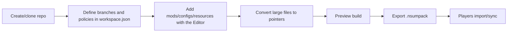

# Pack Authors

This section is for **modpack authors and server maintainers**: maintain an NSUM repository, define branches and sync rules, manage content with the Editor, then build and ship `.nsumpack`.

## Core concepts

| Concept | Description |
|---|---|
| Repository | A Git repository containing `workspace.json`; the single source of truth |
| Modpack branch | `branch[]` entries in `workspace.json` that define content composition |
| Git branch | The code branch checked out during a build |
| Parent branch | Child branches inherit files from their parent |
| Pointer file | A SHA-256 placeholder for large files (mods), downloaded on demand |
| Sync tiers | L1 base, L2 modpack branch, L3 per-save serverconfig |
| `.nsumpack` | The manifest-only exported pack (pack_format 2) |

## Workflow



## Reading order

1. [Repository layout](./repo-structure.md): directories, `workspace.json`, `branch_config`;
2. [Sync rules](./sync-rules.md): L1/L2/L3, `sync_policies`, serverconfig;
3. [Editor UI](./editor-gui.md) and [Editor CLI](./editor-cli.md);
4. [Build and export](./build-and-export.md);
5. [`.nsumpack` format](./nsumpack.md);
6. [Pointers](./pointers.md), [Best practices](./best-practices.md), [Publishing](./publish.md).

## Quick start (CLI)

```powershell
# List branches
NeoWorkspaceEditor.exe info branches --repo <repository>

# Add a client branch
NeoWorkspaceEditor.exe exec branch-add --name client --parent base --type client --repo <repository>

# Write a config
NeoWorkspaceEditor.exe exec file-write --path branches/client/config/client.json --content "{}" --repo <repository>

# Validate
NeoWorkspaceEditor.exe exec validate --repo <repository>

# Build and export (no embedded files by default)
NeoServerUpdateModpack.exe exec build --repo <repository> --modpack client --git-branch main --format nsum --export client.nsumpack
```
