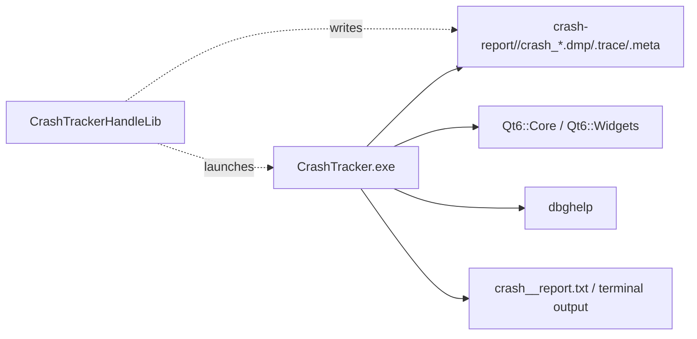

# CrashTracker module

## Overview

`CrashTracker` is the repository's own crash report analysis tool, shipped as `CrashTracker.exe` (no external dependencies beyond Qt, plus a link to `dbghelp`). It reads the three-file set that `CrashTrackerHandleLib` drops into `crash-report/<timestamp>/`, parses the minidump's exception stream and system information, combines them with the application name / help text / crash-type explanations from `.meta`, and produces a readable report.

It has two modes of use: **graphical** (double-click, pick a dump, or let the host launch it on a crash) and **CLI** (`--cli` prints the report directly, for terminal troubleshooting and automation).

## Goals

- **Readable crash scene**: translate the binary minidump into exception code / exception address / modules / call stack / system information;
- **Usable without a host**: it starts on its own and can open any dump through a file dialog;
- **Scriptable**: `--cli` prints a plain-text report and archives it as `crash_<ts>_report.txt` in the same directory;
- **Follows crashes automatically**: two triggers, a "signal file" and a "watched process PID", open the window as soon as the host dies;
- **No side artifacts**: the report only appends one `_report.txt` next to the dump and never modifies `.dmp/.trace/.meta`.

## Boundaries

**What it does**

- `CrashWindow`: parses the minidump (`MiniDumpReadDumpStream` reads the Exception/SystemInfo streams), reads the `.trace` text stack and the `.meta` file (application name, help, CRT message, crash explanations), and `generateReport()` produces the report text;
- Startup modes: standalone window (with an "open dump" entry), a dump path passed directly, `--watch=<signalFile>` / `--watch-pid=<pid>` / `--watch-dir=<dir>` watch modes;
- CLI mode (`--cli`): one report for `<file.dmp|file.trace|file.txt>`, `--list` for every report under `crash-report/`, `--latest` for the newest one;
- Report archiving: writes the generated content as `<dump/trace base name>_report.txt`.

**What it does not do**

- It installs no exception hooks (that is `CrashTrackerHandleLib`'s job);
- No symbol resolution or source line numbers (no PDB download, no symbol server); the call stack only lists addresses and modules;
- No report upload and no statistical aggregation;
- No real-time debugger (it cannot attach breakpoints or resume a debuggee).

## Dependencies

| Dependency | Type | Purpose |
|---|---|---|
| `Qt6::Core` / `Qt6::Widgets` | Qt (PRIVATE) | `QApplication`, the `CrashWindow` UI, file listing and scanning |
| `dbghelp` | system library (PRIVATE) | `MiniDumpReadDumpStream` reads the minidump |
| `crash-report/` directory | runtime input | scans `<exe directory>/crash-report/*/crash_*.dmp` |

## Files

| File | Purpose |
|---|---|
| `src/main.cpp` | entry: CLI parsing (`--cli`/`--list`/`--latest`/file argument), GUI arguments (`--watch*`, direct dump), watch timer, report archiving |
| `src/crash_window.h` | `CrashInfo` struct and the `CrashWindow` declaration |
| `src/crash_window.cpp` | minidump/trace parsing, `.meta` reading, report generation and UI display |
| `src/app.rc` | EXE resources (icon / version block) |
| `CMakeLists.txt` | `add_executable(CrashTracker WIN32 ...)`, `ct_add_version_info` |

## Build integration

- target: `CrashTracker`, an **EXE** (`add_executable(CrashTracker WIN32 src/main.cpp src/crash_window.cpp src/app.rc)`) linking `Qt6::Core`, `Qt6::Widgets` and `dbghelp` (all PRIVATE);
- version resource: `ct_add_version_info(CrashTracker "HiBer2007 software suite universal crash tracking tool" "CrashTracker")` (the file description is localized in the CMake source);
- deploy location: the root `neo_deploy` copies `$<TARGET_FILE:CrashTracker>` to `build/deploy/CrashTracker.exe`, next to the main application (it reuses the Qt runtime DLLs that `windeployqt` places there; CrashTracker does not run `windeployqt` itself);
- it is one of the `neo_deploy` dependencies (the `DEPLOY_DEPS` list), so `--target neo_deploy` builds it as well.

## Public symbols

This target is an EXE with no public headers for other modules to link; only the "report format + directory convention" is reusable. Internal symbols:

| Symbol | Type | Description |
|---|---|---|
| `CrashInfo` | struct | exception name / code / address, system information, crashing module, help text, CRT message, crash description table, module list, call stack |
| `CrashWindow` | class (QMainWindow) | `loadDump(path)`, `loadTraceFile(path)`, `generateReport()`, `info()` |
| `--cli` | CLI | `CrashTracker.exe --cli <file.dmp\|file.trace>` prints and archives a report |
| `--cli --list` / `--cli --latest` | CLI | list `crash-report/` reports / output the newest one |
| `--watch` / `--watch-pid` / `--watch-dir` | CLI (GUI side) | watch a signal file / watch a process exit / watch a directory |

## Related

- [usage.md](./usage.md)
- [CrashTrackerHandleLib module](../CrashTrackerHandleLib/README.md)
- [Testing and crash smoke tests](../../testing.md)
