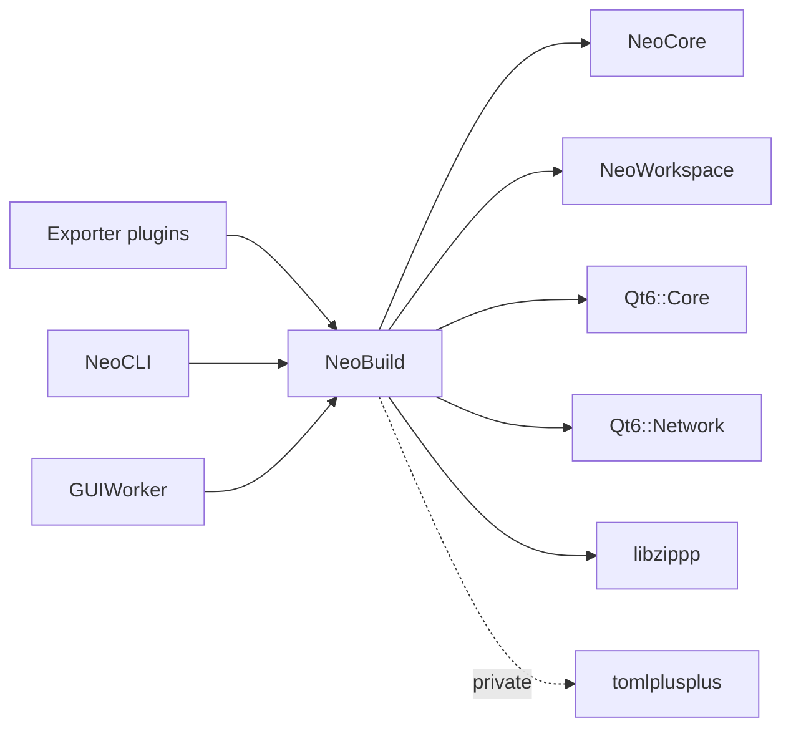

# NeoBuild

## Overview

`NeoBuild` (STATIC) is the build core. It turns a repository into an output directory: it clones or fetches the repository, merges the branch inheritance chain, resolves and downloads pointer files, applies sync policies, writes `serverconfig` into saves, and hands the result to an exporter plugin. The GUI wizard, the CLI (`exec build` / `exec export`) and the workspace editor all build through this module, which is why a build started from anywhere produces byte-identical output.

## Goals

- Reproducible builds: the commit plus `workspace.json` fully determine the output, with no hidden state on disk;
- Plugin-based export and pointer resolution, so new formats and platforms never touch the engine;
- Cancellation and progress carried through every step, so a GUI progress bar and a CLI log show the same thing.

## Boundaries

**What it does**

- `BuildEngine`: `init` / `build` / `exportModpack` / `previewStructure`, plus the individual steps (`stepCloneOrFetch` ... `stepFinalize`, `stepSyncTarget`);
- `BranchMerger`: merges the parent chain into one directory, honouring `delete` / `override` markers;
- `PointerDownloader`: resolver plugin loading, URL resolution, cache reuse, SHA-256 validation, single-stream plus Range parallel download;
- `ModpackExporter`: scans and loads exporter DLLs, exposes `exporterForFormat` for plugin-driven builds;
- `ServerConfigSync`: the L3 `save/[save]/serverconfig` synchronisation;
- `SyncPolicyExecutor`: applies L1 folder and L2 file policies from the merge result to a target working directory;
- `UMD` preview generation, mod-id extraction, and the platform helpers (`getCacheDir`, `findGitExecutable`, disk space).

**What it does not do**

- No UI: the GUI and CLI implement `NeoCore::IBuildProgress` and pass it in;
- No plugin ABI of its own - the interfaces come from `NeoCore`;
- Does not write Git history: commits and pushes stay in `NeoWorkspace::GitOperations` and the editor;
- Does not decide what a modpack looks like - that is the exporter plugin's job.

## Dependencies

| Dependency | Type | Purpose |
|---|---|---|
| `NeoCore` | STATIC, PUBLIC | plugin interfaces, `PluginLoader`, `CancelToken`, `IBuildProgress`, `ParallelDownloader` |
| `NeoWorkspace` | STATIC, PUBLIC | workspace model, Git operations, sync engine, scanner |
| `Qt6::Core` / `Qt6::Network` | library, PUBLIC | `QString`/`QUrl`/network stack for pointer downloads |
| `libzippp::libzippp` | library, PUBLIC | ZIP reading for mod-id extraction and archive previews |
| `tomlplusplus::tomlplusplus` | header-only, **PRIVATE** | `mods.toml` / `neoforge.mods.toml` parsing in `extractModIds` |

## Files

| File | Purpose |
|---|---|
| `include/build_engine.h` | `BuildEngine`, aliases `BuildProgress` / `BuildResult`, step API |
| `include/branch_merger.h` | `BranchMerger`, `BranchLayer`, `MergeResult` |
| `include/pointer_downloader.h` | `PointerDownloader`, `DownloadProgress`, `DownloadResult`, `ResolveResult` |
| `include/modpack_exporter.h` | `ModpackExporter` (exporter plugin registry) |
| `include/serverconfig_sync.h` | `ServerConfigSync`, `ServerConfigEntry`, `ServerConfigMode`, `ServerConfigFolderMode` |
| `include/sync_policy_executor.h` | `SyncPolicyExecutor`, `Result` |
| `include/umd_generator.h` | `generateUmdStructure`, `generateUmdStructureFromLayers` |
| `include/mod_metadata.h` | `extractModIds` |
| `include/platform_api.h` | data/cache/config/temp directories, platform tests, git lookup, disk space |
| `src/build_engine.cpp` | step pipeline, progress reporting, version/`HMCL` metadata generation |
| `src/branch_merger.cpp` | layered merge with manifest markers |
| `src/pointer_downloader.cpp` | resolver lookup, cache, download fallback chain |
| `src/sync_policy_executor.cpp` | L1/L2 execution, `.NSUM/hashes.json`, custom mods handling |
| `src/serverconfig_sync.cpp` | rule loading (`.rule/globle.json`, `.rule/list.json`) and application |

## Build integration

- target: `NeoBuild`, library type **STATIC** (`add_library(NeoBuild STATIC src/build_engine.cpp src/branch_merger.cpp src/modpack_exporter.cpp src/serverconfig_sync.cpp src/pointer_downloader.cpp src/umd_generator.cpp src/sync_policy_executor.cpp src/mod_metadata.cpp src/platform_api.cpp)`);
- include directory: `modules/NeoBuild/include` (PUBLIC), `../NeoCore/include` and `../NeoWorkspace/include` (PRIVATE);
- links `NeoCore`, `NeoWorkspace`, `Qt6::Core`, `Qt6::Network` and `libzippp` **PUBLIC**; `tomlplusplus` stays **PRIVATE** so consumers do not inherit it;
- consumed by `NeoCLI`, `GUIWorker`, `NeoWorkspaceEditor` and every exporter plugin (`NeoExporter_*` link `NeoBuild` because the build runs inside the plugin).

## Public symbols

| Symbol | Type | Description |
|---|---|---|
| `BuildEngine` | class | build entry: `init` / `build` / `exportModpack` / `previewStructure` and the step methods |
| `BuildResult` | struct (alias of `NeoCore::BuildResult`) | `success`, `outputDir`, `errorMessage`, `warnings`, `totalFiles`, `syncedFiles`, `failedFiles` |
| `BranchMerger` | class | parent-chain merge, `loadManifest` / `saveManifest` |
| `MergeResult` | struct | `success`, `mergedFiles`, `overriddenFiles`, `deletedFiles`, `message` |
| `PointerDownloader` | class | resolver scan, `resolveUrl`, `download` / `downloadAll`, cache helpers |
| `ResolveResult` | struct | `success`, `url`, `resolver`, `errorMessage` |
| `ModpackExporter` | class | `scanExporters`, `availableFormats`, `exporterForFormat`, `exportModpack` |
| `ServerConfigSync` | class | L3 sync and its counters |
| `ServerConfigMode` | enum class | `Full`, `Force`, `Partial`, `Ignore` |
| `SyncPolicyExecutor` | class | executes L1/L2 policy from a build directory to a target directory |
| `SyncPolicyExecutor::Result` | struct | `success`, copied/merged/skipped/deleted counters, custom-mod counters, warnings |
| `generateUmdStructure` | function | `U`/`M`/`D` preview tree against a target directory |
| `extractModIds` | function | `std::vector<std::string> extractModIds(const std::string& jarPath)` |
| `getCacheDir` / `getAppDataDir` / `findGitExecutable` | function | platform helpers in `platform_api.h` |

## Related

- [usage.md](./usage.md)
- [Build pipeline](../../architecture/build-pipeline.md)
