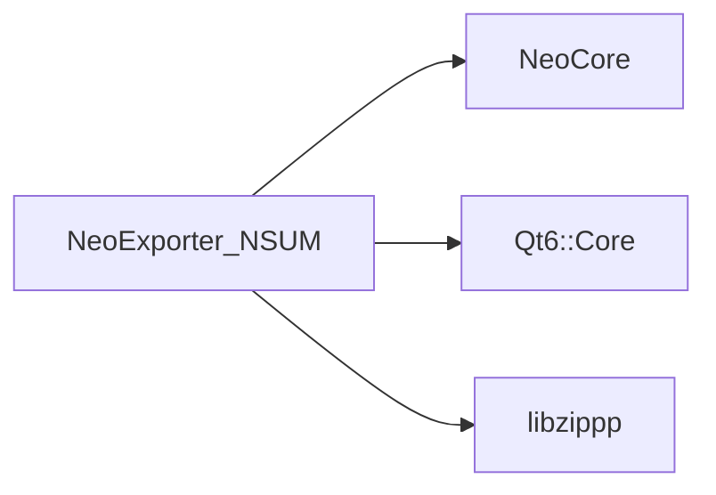

# NeoExporter_NSUM

## Overview

`NeoExporter_NSUM` is an exporter plugin (SHARED) implementing `NeoCore::IModpackExporter`, exporting builds as nsum (.nsumpack).

## Goals

- Pluggable formats; GUI/CLI forms come from meta;
- Exporter provides its build entry (`build_modpack`);
- No UI dependencies.

## Boundaries

**Does**: declare format/extension/fields, build and export.
**Does not**: sync policies or instance markers (engine responsibility).

## Dependencies

## Files

| File | Purpose |
|---|---|
| `src/exporter_*.cpp` | Implementation and `CreateExporter` |
| `NeoExporter_NSUM.meta.json` | Format/extension/fields |
| `CMakeLists.txt` | SHARED target |

## Build integration

- target `NeoExporter_NSUM` (SHARED);
- copied to `exporters/`;
- exports `CreateExporter`.

## Public symbols

| Symbol | Description |
|---|---|
| `CreateExporter` | Factory (`__declspec(dllexport)`) |
| `IModpackExporter` impl | format/extension/build/export |

## Related

- [usage.md](./usage.md)
- [Exporter docs](../../../extensions/exporters/index.md)