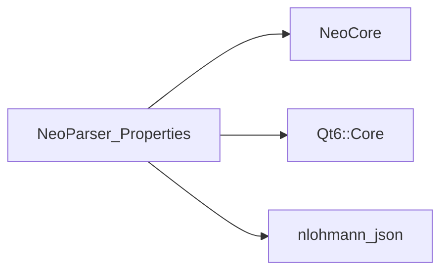

# NeoParser_Properties

## Overview

`NeoParser_Properties` is a runtime config parser plugin (SHARED) implementing `NeoCore::IConfigParser` for Properties configs.

## Goals

- Merge by `tracked_keys`, preserving player-local settings;
- Pair with the editor extension (highlighting/key list);
- Depend only on NeoCore interfaces.

## Boundaries

**Does**: parse configs, merge by key, list keys.
**Does not**: sync files, network, UI.

## Dependencies

## Files

| File | Purpose |
|---|---|
| `src/` | Implementation and `CreateParser` |
| `NeoParser_Properties.meta.json` | Capability declaration |
| `CMakeLists.txt` | SHARED target |

## Build integration

- target `NeoParser_Properties` (SHARED);
- copied to `parsers/` (DLL + meta);
- exports `CreateParser`.

## Public symbols

| Symbol | Description |
|---|---|
| `CreateParser` | Factory (`__declspec(dllexport)`) |
| `IConfigParser` impl | capability/can_handle/parse/merge/list_keys |

## Related

- [usage.md](./usage.md)
- [Parser docs](../../../extensions/parsers/index.md)