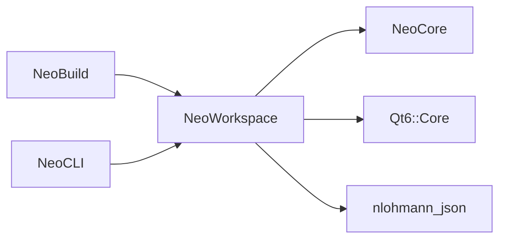

# NeoWorkspace

## Overview

`NeoWorkspace` (STATIC) answers the question "what is a repository". It loads `workspace.json`, models branches and their inheritance, keeps the per-branch file manifest and pointer files, applies sync policies, runs Git commands, hashes and diffs file trees, and records the recently used repositories. `NeoBuild` builds on top of it; the CLI, the GUI layer and the workspace editor reuse it instead of shelling out to Git themselves.

## Goals

- Model the repository layout (`workspace.json` / `branches/` / `branch_config/`) with strong types instead of raw JSON lookups at every call site;
- Make Git operations and sync policies reusable by the CLI, the GUI and the editor, so all three behave identically;
- Keep every filesystem access on UTF-8 paths, so non-ASCII directories work on Windows.

## Boundaries

**What it does**

- `WorkspaceManager`: loads `workspace.json`, resolves branches, parent chains, branch type and server core, effective sync policy, file manifest and pointer files;
- `GitOperations`: clone/fetch/checkout/pull, `rev-parse`/`log`/`status`/`ls-files`, branch creation and listing, commit/push, SSH key helpers, repository trust (`dubious ownership`) handling;
- `BranchManifest` / `FileMarker`: the `branch_manifest.json` layer with `delete` and `override` markers;
- `SyncEngine`: single-file sync through the hash cache plus config merge delegated to `NeoCore::IConfigParser`;
- `SyncPolicy` / `SyncPolicyFile` / `SyncPolicyFolder`: the typed form of `sync_policies` after top-level and branch-level merge;
- `FileScanner`: directory scan, SHA-256, pointer parsing, `DiffResult`;
- `HistoryStore`: recent repositories and their cache directories.

**What it does not do**

- Does not load plugins - parser, pointer and exporter DLLs are `NeoBuild`'s job;
- Does not implement any export format or produce a deploy artifact;
- Does not depend on Qt GUI: only `Qt6::Core` (through `NeoCore`) is used;
- Does not decide sync semantics on its own; it exposes the policy, `NeoBuild::SyncPolicyExecutor` executes it.

## Dependencies

| Dependency | Type | Purpose |
|---|---|---|
| `NeoCore` | STATIC, PUBLIC | `CancelToken`, `ErrorCode`, `IConfigParser`, `PointerInfo`, `fsu8` |
| `Qt6::Core` | library, PUBLIC | `QProcess` for git, `QFile` / `QFileInfo` for hashing and path inspection |
| `nlohmann_json::nlohmann_json` | header-only, PUBLIC | `workspace.json` parsing and `BranchManifest` (de)serialisation |

## Files

| File | Purpose |
|---|---|
| `include/workspace_manager.h` | `WorkspaceManager`, `BranchConfig`, `BranchManifest`, `FileMarker` |
| `include/git_operations.h` | `GitOperations`, `GitResult`, static default git path |
| `include/sync_engine.h` | `SyncEngine`, `SyncResult` |
| `include/sync_policy.h` | `SyncPolicy`, `SyncPolicyFile`, `SyncPolicyFolder` |
| `include/file_scanner.h` | `FileScanner`, `FileEntry`, `DiffResult` |
| `include/history_store.h` | `HistoryStore`, `RecentRepo`, `RepoType` |
| `include/repo_urls.h` | `RepoUrl`, multi-protocol URL helper |
| `include/ssh_key.h` | `SshConfig`, key generation/test/ssh config |
| `src/workspace_manager.cpp` | JSON model, branch resolution, policy merge, manifest IO |
| `src/git_operations.cpp` | Git command execution, output parsing, trust handling |
| `src/sync_engine.cpp` | hash cache, safe copy/write, config merge plumbing |
| `src/file_scanner.cpp` | recursive scan, SHA-256, exclude patterns, pointer detection |
| `src/history_store.cpp` | history file read/write under the application data directory |

## Build integration

- target: `NeoWorkspace`, library type **STATIC** (`add_library(NeoWorkspace STATIC src/workspace_manager.cpp src/git_operations.cpp src/sync_engine.cpp src/file_scanner.cpp src/history_store.cpp src/repo_urls.cpp src/ssh_key.cpp)`);
- include directory: `modules/NeoWorkspace/include` (PUBLIC) plus `../NeoCore/include` (PRIVATE);
- links `NeoCore`, `Qt6::Core` and `nlohmann_json` **PUBLIC**, so consumers of `NeoWorkspace` get the whole set;
- consumed by `NeoBuild` (PUBLIC, and therefore transitively by `NeoCLI` and `GUIWorker`), by `NeoCLI` directly, and by `NeoWorkspaceEditor`.

## Public symbols

| Symbol | Type | Description |
|---|---|---|
| `WorkspaceManager` | class | workspace model: load/validate, branches, manifest, pointer files, sync policy |
| `WorkspaceManager::BranchConfig` | struct | `name`, `parent`, `gameVersion`, `modloader`, `modloaderVersion`, `description`, `hidden`, `type` (`universal`/`client`/`server`), `core` |
| `BranchManifest` | struct | per-branch `delete`/`override` marker map, JSON (de)serialisation |
| `FileMarker` | enum class | `None`, `Delete`, `Override` |
| `GitOperations` | class | Git commands, `SetDefaultGitPath` / `GetDefaultGitPath`, SSH helpers |
| `GitResult` | struct | `exitCode`, `stdoutOutput`, `stderrOutput`, `errorCode` |
| `SyncEngine` | class | file sync, hash cache, config merge |
| `SyncResult` | struct | `success`, `syncedFiles`, `conflictedFiles`, `failedFiles`, `messages` |
| `SyncPolicy` | struct | effective policy: `defaultFolderPolicy`, `folders`, `files`, `configFiles` |
| `FileScanner` | class | scan/hash/diff, `parsePointerFile` |
| `HistoryStore` | class | `MaxRecentRepos` (10), read/save recent repositories |
| `RecentRepo` | struct | `type`, `location`, `cachePath` |

## Related

- [usage.md](./usage.md)
- [Data model](../../architecture/data-model.md)
