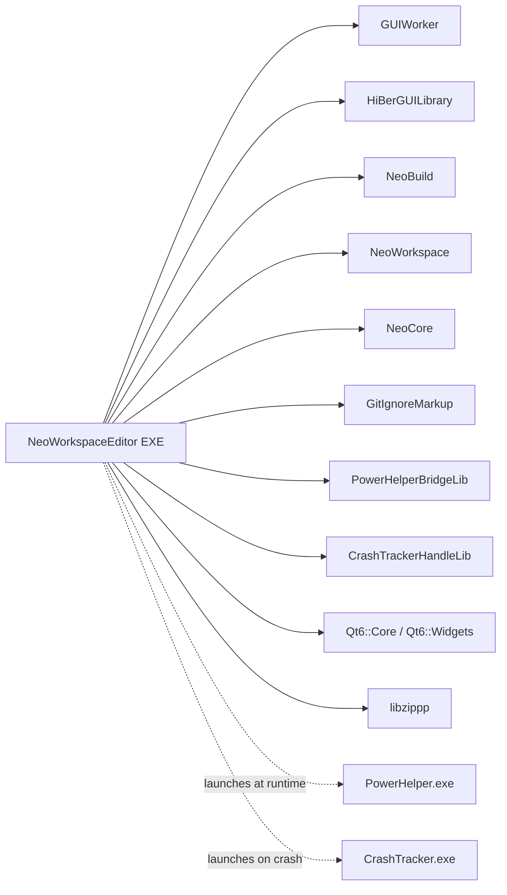

# NeoWorkspaceEditor module

## Overview

`NeoWorkspaceEditor` (artifact `NeoWorkspaceEditor.exe`) is NSUM's **repository configuration editor**: its GUI edits `workspace.json`, the branch tree, branch content (`branches/<name>/`), pointers and sync policies, and an embedded Git panel handles staging, commits and pushes. The same EXE has a second form - a **GUI-less CLI** with the `info` / `exec` / `help` subcommands that emits a single JSON object, so AI agents and unattended scripts can operate a repository.

It is a "thin shell": the data model and page widgets come from `GUIWorker` (`RepoEditor`/`BranchEditor`/`ModpackContentIde`), domain capabilities from `NeoWorkspace`/`NeoBuild`, widgets from `HiBerGUILibrary`, and help documents are launched through `PowerHelperBridgeLib`.

## Goals

- **One implementation for GUI and CLI**: the CLI reads and writes `workspace.json`, `branches/` and `branch_config/` exactly like the GUI does;
- **Automation-ready**: CLI stdout carries exactly one JSON object (logs go to stderr) with explicit 0/1/2 exit codes;
- **Path-safe**: every CLI path is confined to the repository; absolute paths and `..` are rejected;
- **Visible startup**: while loading, a layered terminal TUI renders (banner text, scrolling logs, progress bar) and the buffered log is replayed once the window is ready;
- **Observable**: crash backstop (`CrashTrackerHandleLib`), logging (`CommonLoggerCPP`, `workspace_editor.log`/`editor`) and heap checkpoints (Debug).

## Boundaries

**What it does**

- Opens, creates and clones repositories (four sources: local, remote cache, clone, new) and saves or saves-as `workspace.json`;
- Branch editing: inheritance chain, type (`universal`/`client`/`server`), server core, description/hidden flag, branch properties dialog;
- Content editing: repository tree + output tree + file content editor (syntax highlighting by parser), pointers, custom mods, server config sync settings;
- Git: status/history/stage/commit/push/pull (`GitPanel`, asynchronous);
- CLI: `info` (workspace/branches/branch/tree/pointers/sync/file/git) and `exec` (branch-*/file-*/json-*/pointer-*/validate/git-*);
- On startup it promotes the hidden in-package `docs/_editor/<lang>/pack-author` into the regular documentation tree (which only happens when the editor is installed).

**What it does not do**

- No modpack build or export (that is the main application + `NeoBuild` + exporter plugins);
- No git semantics of its own (it only calls git through `GitOperation`/`QProcess`, with constraints on force operations);
- No GUI pages rendered in CLI mode (the CLI has no `QApplication`, only a `QCoreApplication`);
- No client instance or sync management (the bridge side owns that).

## Dependencies

| Dependency | Type | Purpose |
|---|---|---|
| `GitIgnoreMarkup` | STATIC | the `.gitignore` editing dialog |
| `NeoCore` | STATIC | plugin interfaces, cancellation, path helpers, progress |
| `NeoWorkspace` | STATIC | `WorkspaceManager`/`GitOperations`/sync policy model |
| `NeoBuild` | STATIC | build output preview (U/M/D output tree) |
| `GUIWorker` | STATIC | domain page widgets (`RepoEditor`/`BranchEditor`/`ModpackContentIde`) |
| `HiBerGUILibrary` | STATIC | general widgets (tree panels, editor, Git panel, progress card) |
| `PowerHelperBridgeLib` | STATIC | opening help documents |
| `CrashTrackerHandleLib` | STATIC | crash backstop |
| `Qt6::Core` / `Qt6::Widgets` | Qt | Qt infrastructure for GUI and CLI |
| `libzippp::libzippp` | third-party library | backup export (zip) |

## Files

| File | Purpose |
|---|---|
| `src/main.cpp` | entry dispatch: docs promotion -> CLI detection -> console policy -> TUI loading layer -> `EditorWindow`; crash/log wiring and `install.conf` git path injection |
| `src/editor_cli.h` / `editor_cli.cpp` | GUI-less CLI: `is_cli_invocation`, `run`, every `info`/`exec`/`help` subcommand and the JSON output |
| `src/editor_tui.h` / `editor_tui.cpp` | loading-time layered TUI (`TuiLogSink` buffered logs, banner text, progress bar) |
| `src/editor_window.h` / `editor_window.cpp` | main window: menus/toolbar/branch selector/three tabs (repository settings, branch management, modpack content)/Git panel/loading card |
| `src/branch_meta_dialog.h` / `.cpp` | branch properties dialog (description, hidden flag and similar) |
| `src/app.rc` | resources and version block (`nsum_add_version_info`) |

## Build integration

- target: `NeoWorkspaceEditor`, an **EXE** (`add_executable(NeoWorkspaceEditor ...)`, **console subsystem** - in GUI mode a `holdOrReleaseConsole`-style policy keeps or releases the terminal so logs are visible when started from a terminal);
- links (PRIVATE): `GitIgnoreMarkup`, `NeoCore`, `NeoWorkspace`, `NeoBuild`, `GUIWorker`, `HiBerGUILibrary`, `PowerHelperBridgeLib`, `CrashTrackerHandleLib`, `Qt6::Core`, `Qt6::Widgets`, `libzippp::libzippp`;
- version resource: `nsum_add_version_info(NeoWorkspaceEditor "NSUM repository manager - workspace configuration editor" "NSUM build tools")` (the source strings are localized);
- ASan: `-DNSUM_ASAN=ON` adds `/fsanitize=address` to `NeoCore`/`NeoBuild`/`NeoWorkspace`/`GUIWorker`/`HiBerGUILibrary`/`CrashTrackerHandleLib` and to this EXE;
- deploy location: the root `neo_deploy` copies `$<TARGET_FILE:NeoWorkspaceEditor>` into `build/deploy/` and runs `windeployqt` on `deploy/NeoWorkspaceEditor.exe` (`--no-translations --no-opengl-sw --no-compiler-runtime --no-system-d3d-compiler`);
- the CLI JSON contract is maintained together with the editor CLI documentation (the repository also keeps `docs/editor-cli.md` as an earlier description; on the site this page and [usage](./usage.md) are authoritative).

## Public symbols

This target is an EXE with no public headers to link against; its external contract is the **command line and the JSON output**.

| Symbol | Type | Description |
|---|---|---|
| `editor_cli::is_cli_invocation` | function | routes to the CLI when the first non-program argument is `info`/`exec`/`help` |
| `editor_cli::run` | function | runs the CLI and returns 0/1/2 |
| `EditorWindow` | class (QMainWindow) | `loadWorkspace`/`saveWorkspace`/`saveWorkspaceAs`/`isModified` |
| `RepoSource` | enum class | `Local`/`RemoteCache`/`Clone`/`New` |
| `nsum_tui::EditorTui` | class | loading-time TUI: `start`/`stop`/`setStatus`/`setProgress` |
| `nsum_tui::TuiLogSink` | class (spdlog sink) | buffers log lines for TUI replay |

## Related

- [usage.md](./usage.md)
- [Repository editor (GUI)](../../../pack-author/editor-gui.md)
- [Editor CLI](../../../pack-author/editor-cli.md)
- [ADR 0008 - Editor CLI](../../adr/0008-editor-cli.md)
