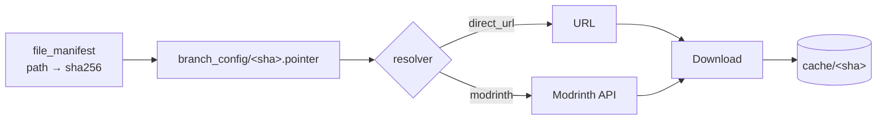

# Pointer System

## Structure



## Pointer file

```json
{
  "resolver": "direct_url",
  "metadata": { "url": "https://example.com/a.jar" },
  "sha256": "<64 hex>",
  "size": 1234
}
```

- Filename = target content SHA-256;
- The pointer has no target path; `file_manifest` links it;
- `pointer_files` stores resolver/metadata (kept in sync with `.pointer`).

## Resolution

1. The build finds a missing target or hash mismatch;
2. Read the hash from `file_manifest` → look in `branches/.../content` or the cache;
3. On cache hit, verify and copy;
4. On miss, resolve with the resolver, download, verify, cache.

## Cache

| Location | Use |
|---|---|
| `.minecraft/versions/.cache/<sha256>` | Build side |
| `.hmcl/nsum/cache/files/<sha256>` | bridge embedded files |

## Zero trust

- Recompute SHA-256 before using any cache entry;
- Mismatch → delete and re-download;
- Protects against disk corruption, concurrent writes, silent tampering.

## Failure modes

| Symptom | Cause |
|---|---|
| `No resolver found` | Resolver missing/`resolver` name wrong |
| `SHA-256 hash mismatch` | Corrupted cache/tampered download |
| URL 404 | Dead direct link |

## Extending

Implement `IPluginPointer` + export `CreatePointer()` + meta.json, place in `pointers/`.

## Related

- [Downloader](./downloader.md)
- [Pointers (author)](../../pack-author/pointers.md)
