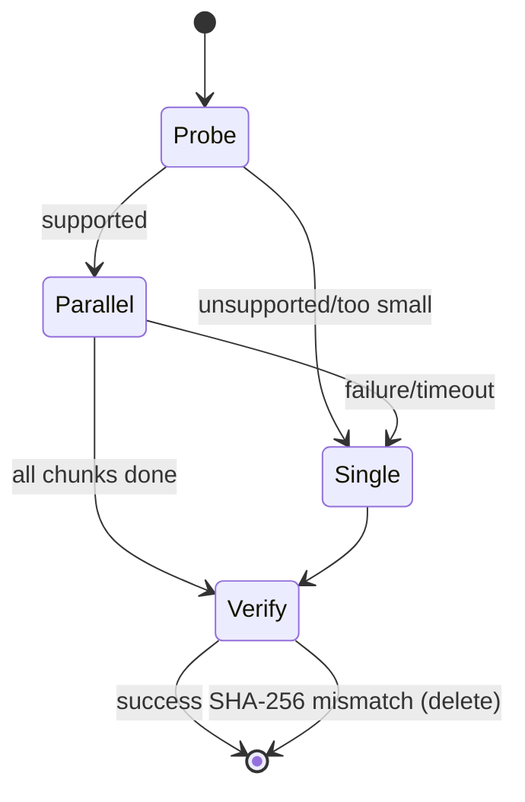

# Bridge Downloads

`NSumParallelDownloader` downloads Runtime packages and embedded files, with the same strategy as the C++ downloader but an independent Java implementation.

## Probing

- Probe with `GET` + `Range: bytes=0-0` (**not HEAD**: `HttpURLConnection` HEAD does not follow GitHub 302);
- Read `Content-Range` for total size and `Accept-Ranges`.

## Chunks

- When Range is supported and the file is large enough, slice by thread count;
- Write with `FileChannel.write(buffer, position)`;
- A per-process `Semaphore` caps 32 connections per server;
- Verify the size after all chunks complete.

## Fallback and timeout

- **A total deadline (10 minutes) is mandatory**;
- Any chunk failure triggers `shutdownNow`, deletes the target and falls back to single stream;
- Single-stream failure propagates to the caller.

> Measured: parallel chunks can hang at 0 bytes through proxies; a Java run once took 11 hours, hence the timeout/fallback requirement.

## Configuration

`<HMCL>/.hmcl/nsum/download.properties`:

```properties
threads=8
minSizeMB=8
enabled=true
```

Or JVM flags:

```text
-Dnsum.download.threads=8
-Dnsum.download.minSizeMB=8
-Dnsum.download.enabled=false
```

| Key | Default | Description |
|---|---|---|
| `threads` | 8 | Chunk count (max 16) |
| `minSizeMB` | 8 | Smaller files use single stream |
| `enabled` | true | Disable to force single stream |

## State machine



## Embedded file cache

- `embedded[]` files are stored by SHA-256 in `.hmcl/nsum/cache/files/`;
- Cache hits are copied and verified;
- Misses are extracted from the pack, verified and cached.

## Related

- [Task chain](./tasks.md)
- [.nsumpack](../../pack-author/nsumpack.md)
