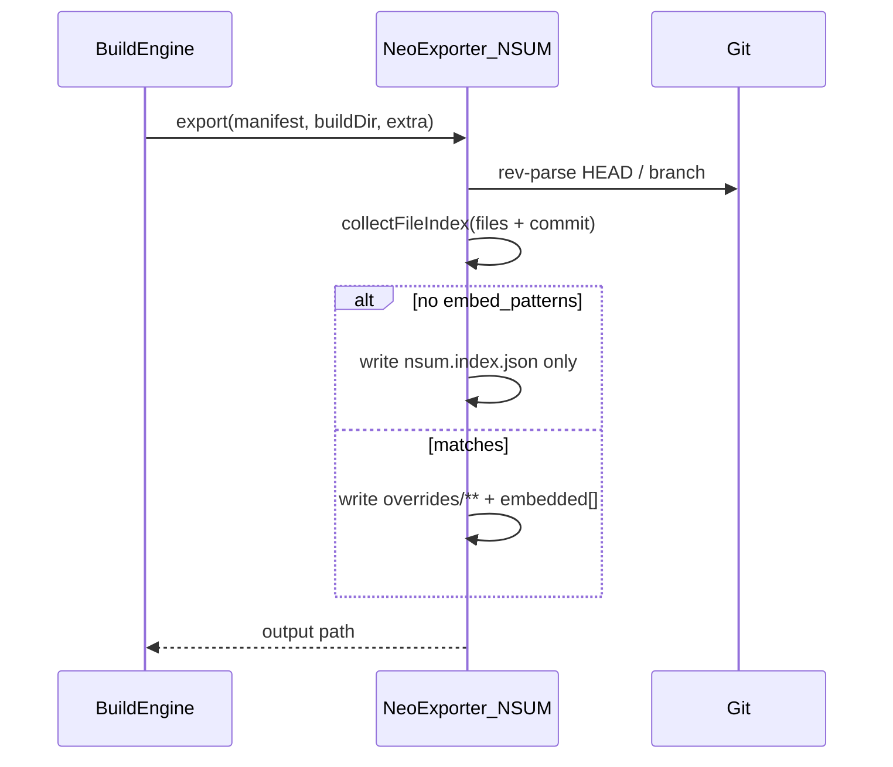

# NSUM Exporter

`NeoExporter_NSUM` produces `.nsumpack`: **manifest-only by default**; files are synced from the repository. Only explicitly declared `embed_patterns` are placed in `overrides/`.

## Metadata

| Item | Value |
|---|---|
| format | `nsum` |
| extension | `.nsumpack` |
| required | `name`, `version` |
| optional | `author`, `description`, `embed_patterns` (advanced, multiline) |

## Layout

```text
<pack>.nsumpack
├─ nsum.index.json          # manifest (~1 KB)
└─ overrides/**             # only with embed_patterns matches
```

`nsum.index.json` (`pack_format: 3`) fields:

| Field | Description |
|---|---|
| `pack_format` / `schema` | `3` (file structure version, since 1.0.6) |
| `type` | `nsum` |
| `name` / `version` / `author` / `description` | Pack metadata |
| `gameVersion` / `modloader` / `modloaderVersion` | Game and loader |
| `repository.url` | Primary repository URL (legacy) |
| `repository.urls` | SSH/HTTPS/HTTP URL list (since 1.0.6) |
| `repository.default_branch` | Default Git branch |
| `repository.branch` | Modpack branch |
| `repository.git_branch` | Git branch used to build |
| `repository.commit` | Build commit |
| `files[]` | `path`/`size`/`sha256`/`commit`/`git_branch` (metadata only) |
| `embedded[]` | Embedded files + `pattern` + `sha256` + source commit |
| `embed_patterns[]` | Declared regexes |
| `runtime.minVersion` | Minimum Runtime version |

## Embed rules

- Regexes match repository-relative paths (ECMAScript `search`);
- Separate multiple regexes with newlines or `;`;
- `save/` is never embedded;
- Invalid regex fails the export.

```powershell
# Default: manifest only
NeoServerUpdateModpack.exe exec build --repo <repository> --modpack base --git-branch main `
    --format nsum --export plain.nsumpack

# Explicitly embed config JSON
NeoServerUpdateModpack.exe exec build --repo <repository> --modpack base --git-branch main `
    --format nsum --embed-patterns '^config/.*\.json$' --export embed.nsumpack
```

## Export sequence



## Client behavior

- bridge reads `repository` and `embedded[]`;
- Embedded files are cached by SHA-256 in `.hmcl/nsum/cache/files/`;
- Legacy packs (no `embedded`) extract all `overrides/`.

## Related

- [`.nsumpack` format](../../pack-author/nsumpack.md)
- [Build and export](../../pack-author/build-and-export.md)
