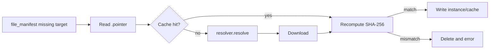

# Pointer Resolvers

Pointer files are named by the target SHA-256 (`branch_config/<sha256>.pointer`) and store only "how to fetch"; **resolvers** turn that into a URL.

## Overview

| Resolver | Capability | Typical use |
|---|---|---|
| NeoPointer_DirectURL | Direct download | Any HTTPS link, CI artifacts, mirrors |
| NeoPointer_Modrinth | Modrinth API | Official URLs via `project_id`/`version_id` |

## Contract

Implement `NeoCore::IPluginPointer`:

| Method | Purpose |
|---|---|
| `name()` | Resolver name |
| `can_handle()` | Metadata support |
| `resolve_url()` | Produce a URL |
| `validate()` | Post-download verification |

Factory:

```cpp
extern "C" __declspec(dllexport) NeoCore::IPluginPointer* CreatePointer();
```

## Pointer format

```json
{
  "resolver": "direct_url",
  "metadata": { "url": "https://example.com/mods/example.jar" },
  "sha256": "<64 hex>",
  "size": 123456
}
```

## Resolve and cache



## Related

- [DirectURL](./direct-url.md) · [Modrinth](./modrinth.md)
- [Pointers (author)](../../pack-author/pointers.md)
