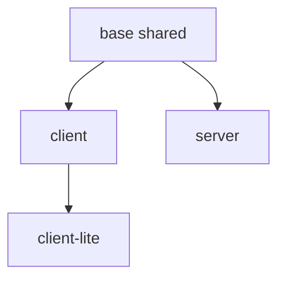

# Best Practices

## Directories

- Put shared content in `branches/base/`; keep only differences in `client/` and `server/`;
- Group configs by mod/feature instead of piling files at the root;
- Convert large files (>1 MB) to pointers;
- Use `save/` only for serverconfig, never for world saves.

## Size

| Content | Practice |
|---|---|
| mods/*.jar | Pointers + content-addressed cache |
| Resource packs/shaders | Pointers (or `custom_mods`) |
| Small configs | Commit directly |
| Required offline | Explicit embedding in `.nsumpack` (small amount) |

## Branch splitting

- Client-only mods go to `client`;
- Server cores/plugins go to `server`;
- Mark `type=client/server` to prevent misuse.

## Sync policies

| Scenario | Policy |
|---|---|
| Server-enforced content | `mirror` |
| Players may add content | `incremental_add` |
| Keep player settings | file-level `partial` + `tracked_keys` |
| Logs/caches | `skip` |

## Commits

- One change per commit (add mod / edit config / bump version separately);
- Run `exec validate` and `info preview` before committing;
- Do not commit `build/`, `logs/`, `crash-report/`, `.NSUM/`;
- Manage `.gitignore` with marked blocks (GitIgnoreMarkup).

## Pre-release checklist

- [ ] workspace version/loader correct;
- [ ] Parent chain acyclic, `validate` passes;
- [ ] Large files converted to pointers;
- [ ] `info preview` file count as expected;
- [ ] Package size normal (~1 KB by default);
- [ ] Client import/sync/launch tested;
- [ ] Server branch launch tested.

## Related

- [Sync rules](./sync-rules.md)
- [Publish](./publish.md)
