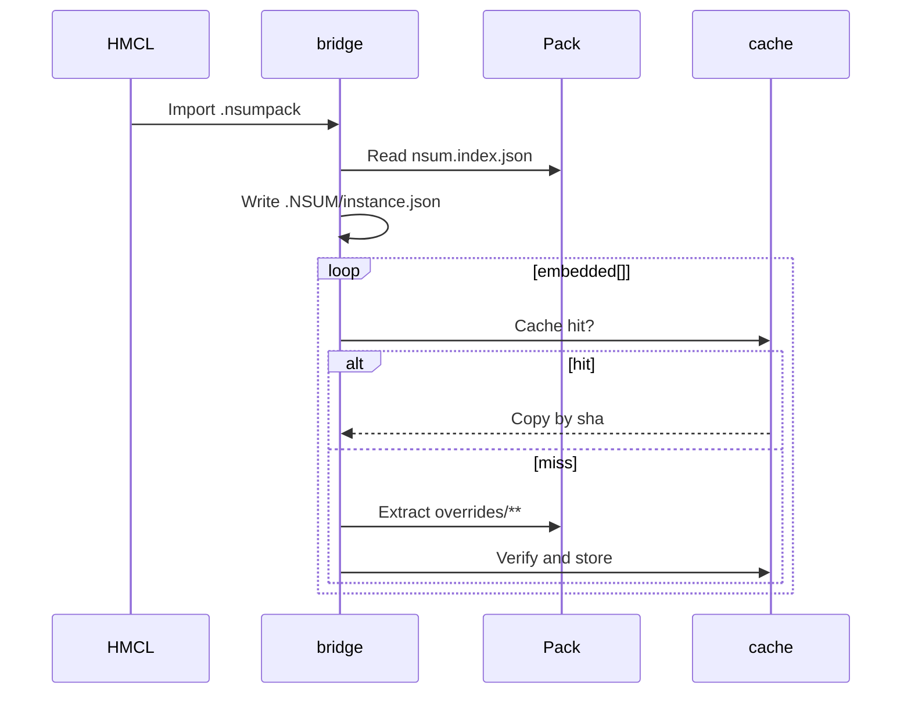

# The `.nsumpack` Format

> **Version**: `pack_format` / `schema` are **3** since 1.0.6 (adds `repository.urls`); `pack_format: 2` packs from 1.0.5 remain supported.

`.nsumpack` is NSUM's distribution format: **manifest-only by default**; clients sync files from the repository. Files are embedded only when `embed_patterns` is declared explicitly.

## Layout

```text
<pack>.nsumpack
├─ nsum.index.json      # manifest
└─ overrides/**         # only with explicit embedded files
```

## Minimal manifest

```json
{
  "pack_format": 2,
  "schema": 2,
  "type": "nsum",
  "name": "My Pack",
  "version": "1.0.0",
  "author": "author",
  "gameVersion": "1.21.1",
  "modloader": "neoforge",
  "modloaderVersion": "21.1.209",
  "repository": {
    "url": "git@github.com:owner/repo.git",
    "urls": [
      { "type": "ssh", "url": "git@github.com:owner/repo.git" },
      { "type": "https", "url": "https://github.com/owner/repo.git" },
      { "type": "http", "url": "http://github.com/owner/repo.git" }
    ],
    "default_branch": "main",
    "branch": "base",
    "git_branch": "main",
    "commit": "<40 hex>"
  },
  "files": [
    { "path": "mods/example.jar", "size": 1234, "sha256": "<64 hex>", "commit": "<40 hex>", "git_branch": "main" }
  ],
  "embedded": [],
  "embed_patterns": [],
  "runtime": { "minVersion": "1.0.0" }
}
```

## Fields

| Field | Description |
|---|---|
| `pack_format` / `schema` | File structure version (2), unrelated to pack version |
| `repository.url` | Primary repository URL (legacy field, still written; clients prefer `urls`) |
| `repository.urls` | Ordered URL list: `ssh` / `https` / `http`; clients fall back in order (since 1.0.6 / pack_format 3) |
| `repository.default_branch` | Default Git branch |
| `repository.branch` | Modpack branch |
| `repository.git_branch` / `commit` | Git branch and commit used to build |
| `files[]` | File index (metadata only, no bytes) |
| `embedded[]` | Actually embedded files (with `pattern`, sha256, commit, git_branch) |
| `embed_patterns[]` | Regexes declared for this export |
| `runtime.minVersion` | Minimum Runtime version |

## Embed rules

- Regexes match repository-relative paths with ECMAScript `search`;
- Multiple regexes separated by newlines or `;`;
- `save/` is never embedded;
- Invalid regex fails the export.

```powershell
NeoServerUpdateModpack.exe exec build --repo <repository> --modpack base --git-branch main `
    --format nsum --embed-patterns '^config/.*\.json$' --export out.nsumpack
```

## Import sequence



## Cache

- Path: `.hmcl/nsum/cache/files/<sha256>`;
- Reused across packs/instances;
- Legacy packs (no `embedded`) extract all `overrides/`.

## Size practices

| Content | Recommendation |
|---|---|
| Mods/resource packs | Pointers, not embedded |
| Configs required offline | Embed explicitly |
| Player-specific configs | Do not embed (sync policy merge) |

## Related

- [Build and export](./build-and-export.md)
- [Pointers](./pointers.md)
