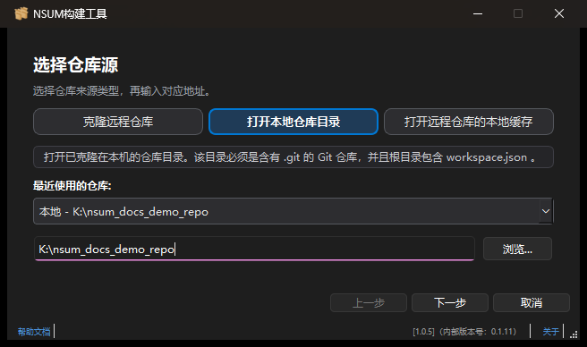
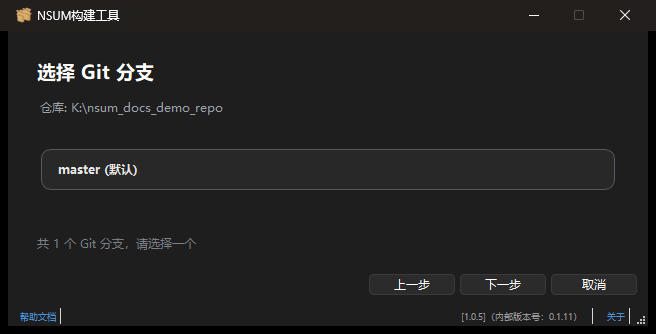
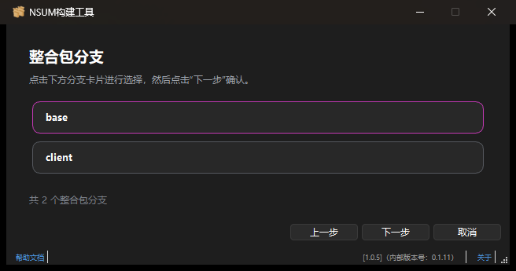
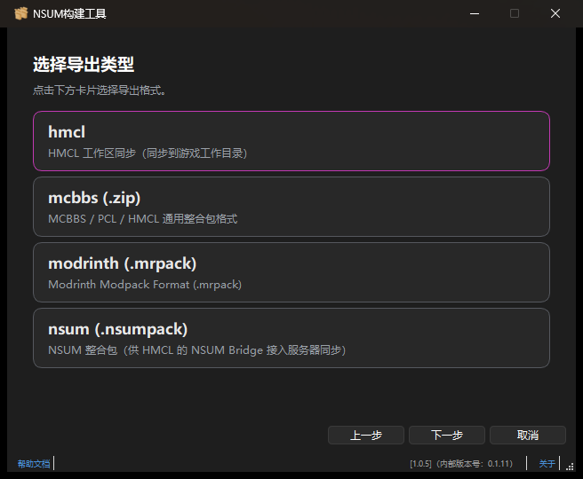
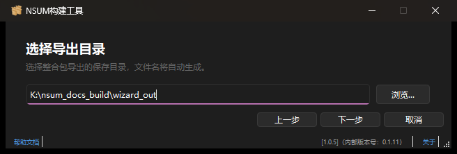
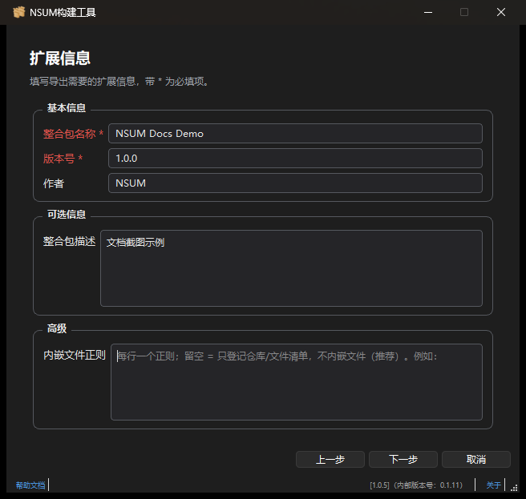
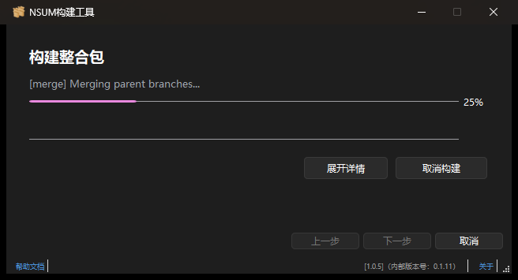

# Launcher UI
















The NSUM main program (`NeoServerUpdateModpack.exe` without arguments) is the graphical build tool for pack authors; players mainly use the NSUM page inside HMCL. This page describes the common screens of the main program GUI.

## Start

```powershell
# Open the GUI
.\NeoServerUpdateModpack.exe

# Open directly with a repository
.\NeoServerUpdateModpack.exe --repo <repository path>
```

## Build wizard

The wizard collects build parameters in order; every step can go back.

| Page | Content |
|---|---|
| Repository | Choose a local repository, clone a remote one, or open from history |
| Branch | Choose the **modpack branch** (build source) |
| Modpack | Choose the modpack (from `workspace.json` branches) |
| Export type | MCBBS / Modrinth / HMCL / NSUM (`.nsumpack`) |
| Export directory | Output location; HMCL format is a sync directory |
| Extra info | Exporter fields (name, version, author, description, embed patterns…) |
| Checklist | Summary of actions before starting |
| Build | Live log, overall progress, sub-task progress, cancel |
| Done | Result, warnings, open output folder/help |

### Build page

- **Overall progress**: clone → merge → download → export;
- **Sub-task bars**: parallel downloads/sync tasks (pointers, file copies);
- **Log panel**: collapsible, full build log;
- **Cancel**: safely cancels the current build (downloaded cache is kept).

### Done page

- Success: output path and warning count;
- Failure: error summary and "Open help docs";
- Warnings: usually optional missing files or pointer failures; inspect the log.

## History and cache

- "Repository → History" stores recently opened repositories (local/remote/cache);
- Remote repositories are cached under `config/history/cache/` and fetched when reopened;
- Build cache lives in the system temp/cache directory; pointer files are reused by SHA-256.

## Settings

| Setting | Description |
|---|---|
| Git path | Bundled Git (`tools/git`) by default; falls back to system Git |
| Log level | `NSUM_LOG_LEVEL=trace/debug/info/warn/error/off` |
| Language | GUI Chinese, CLI English |

## CLI equivalents

```powershell
# List modpack branches
.\NeoServerUpdateModpack.exe info modpacks --repo <repository> --json

# Preview build structure
.\NeoServerUpdateModpack.exe info preview --repo <repository> --modpack base --format nsum --json

# Headless build + export
.\NeoServerUpdateModpack.exe exec build --repo <repository> --modpack base --git-branch main --format nsum --export out.nsumpack
```
