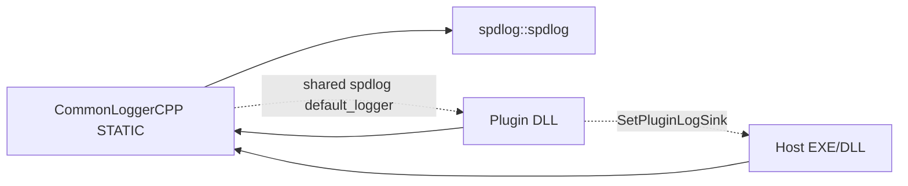

# CommonLoggerCPP module

## Overview

`CommonLoggerCPP` is the repository-wide logging module (a git submodule of the standalone `CommonLoggerCPP` repository, LGPL-2.1). It solves spdlog initialization, sink composition and cross-module visibility in one place: the class is `CLogger` and lives in the **global namespace** (no `NeoCore::`-style wrapper), so every target - main application, editor, plugin DLLs - calls `CLogger::Info(...)` directly.

This page covers its responsibility boundary, dependencies, build integration and the injectable plugin log channel.

## Goals

- **Zero business dependencies**: only spdlog is required, so the module builds and is reusable on its own;
- **Single-point initialization**: `Init` is idempotent and never throws on repeated calls, preventing the process abort caused by registering the same logger name twice (historical incident: a second `register_logger` threw `0xE06D7363`);
- **Reachable across DLLs**: in a static library build each plugin DLL holds its own `CLogger::instance_`, which is always null inside a plugin - `Resolve()` falls back to spdlog's shared `default_logger()`, so plugins reach host logging without code changes;
- **Optional plugin log channel**: a plugin that exports `SetPluginLogSink` receives the host sink (with a plugin-name prefix); one that does not export it falls back to `CLogger`, keeping old plugins compatible;
- **Controllable terminal**: `HoldConsole()` idempotently sets the UTF-8 code page, VT processing and unbuffered binary streams, so ANSI colors and UTF-8 text are not rewritten by the CRT.

## Boundaries

**What it does**

- Provides `CLogger`: `Init`/`Get`/`Resolve`/`HoldConsole`/`SetLevel`/`AddSink` plus the `Trace`/`Debug`/`Info`/`Warn`/`Error` template methods;
- Combines a colored stdout sink with a file sink (`basic_file_sink_mt`, append mode);
- Reads the `NSUM_LOG_LEVEL` environment variable to override the log level;
- Provides the plugin log injection contract: `ILogSink`, the host default implementation `LoggerLogSink`, and the `NEO_DECLARE_PLUGIN_LOG_SINK` macro.

**What it does not do**

- No log rotation or compression (stdout plus a single appended file is the whole story);
- No business progress reporting (progress belongs to `NeoCore::IBuildProgress`);
- No GUI log panel - the UI side attaches a custom spdlog sink through `AddSink`;
- No log file lifecycle or directory cleanup management.

## Dependencies

| Dependency | Type | Purpose |
|---|---|---|
| `spdlog::spdlog` | third-party library (vcpkg, PUBLIC) | logger instances, sink implementations, level control |
| Consumers (EXE/DLL) | - | call `CLogger::*`; plugin DLLs receive the host sink through an exported symbol |

## Files

| File | Purpose |
|---|---|
| `include/logger.h` | `CLogger` definition and all inline logging methods |
| `include/plugin_log_sink.h` | `ILogSink` / `LoggerLogSink` / `NEO_DECLARE_PLUGIN_LOG_SINK` plugin log contract |
| `src/logger.cpp` | `instance_`, `Init`, `Resolve`, `HoldConsole`, `SetLevel`, `AddSink` implementations |
| `CMakeLists.txt` | target definition and the `COMMONLOGGER_BUILD_EXAMPLES` option |
| `examples/main.cpp` | minimal usage example |
| `LICENSE` / `vcpkg.json` | LGPL-2.1 license and the dependency manifest for standalone builds |

## Build integration

- target: `CommonLoggerCPP` (`add_library(CommonLoggerCPP STATIC src/logger.cpp ...)`), library type **STATIC**;
- include directory: `modules/CommonLoggerCPP/include`, exposed as `PUBLIC`; `spdlog::spdlog` is linked `PUBLIC` as well, so consumers do not need their own `find_package(spdlog)`;
- linked **PUBLIC** by `NeoCore`, which propagates it to the whole repository (NeoWorkspace / NeoBuild / NeoCLI / GUIWorker / main application / editor / plugins);
- being a static library it has **no standalone deploy artifact**; log files (`builder.log` / `gui.log` / `editor.log` / `core.log`) are created by each process in its own working directory.

## Public symbols

| Symbol | Type | Description |
|---|---|---|
| `CLogger` | class (global namespace) | logging facade, all members static |
| `CLogger::Level` | enum class | `Trace/Debug/Info/Warn/Error/Off`, values aligned with spdlog levels |
| `CLogger::Init` | static function | `Init(logFile = "core.log", loggerName = "core")`, idempotent |
| `CLogger::Get` / `Resolve` | static function | obtain the logger; `Resolve` falls back to `spdlog::default_logger()` when the pointer is null |
| `CLogger::HoldConsole` | static function | idempotent console setup (UTF-8 code page, VT, unbuffered) |
| `CLogger::SetLevel` / `AddSink` | static function | change level at runtime, append a sink |
| `CLogger::Trace/Info/Error/Warn/Debug` | static template | `fmt`-style formatted output |
| `ILogSink` | interface | plugin log callback: `log(int level, const std::string& message, const char* pluginName)` |
| `LoggerLogSink` | class | host default implementation: forwards to `CLogger` with a `[plugin-name]` prefix |
| `NEO_DECLARE_PLUGIN_LOG_SINK` | macro | expands to the exported `SetPluginLogSink` symbol and `PluginLog(level, msg)` |
| `PluginLog` | function (macro product) | plugin-side logging: uses the sink when present, otherwise falls back to `CLogger` |

## Related

- [usage.md](./usage.md)
- [Plugin contracts](../../framework/plugin-contracts.md)
- [Extension and plugin registry](../../framework/extension-registry.md)
