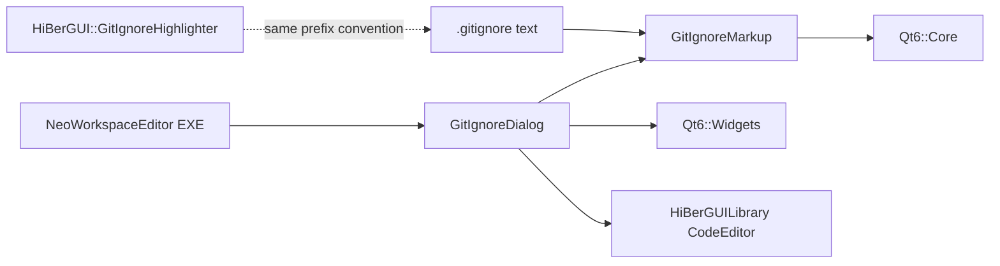

# GitIgnoreMarkup module

## Overview

`GitIgnoreMarkup` (a git submodule of the standalone `GitignoreMarkup` repository, LGPL-2.1) upgrades `.gitignore` from "a pile of text lines" into **round-trippable structured data**: it can mark a rule as "temporarily disabled without deleting it", attach a "next-line label" and group labels to rules, and still keep the file a legal `.gitignore` for browsers and git - every marker is written as a `#` comment prefix.

It is split into two layers: the pure logic `GitIgnoreMarkup::parseLines/serialize` (only depends on Qt Core and is reusable from a CLI or any other host) and the editing dialog `GitIgnoreMarkup::GitIgnoreDialog` (depends on Qt Widgets plus `HiBerGUILibrary`'s `CodeEditor`).

This page answers: what the marker format is, what parsing and serialization guarantee, and where the module boundary and build integration are.

## Goals

- **Standard lines stay standard**: an active rule is one plain line, so git behavior is unchanged;
- **Reversible editing**: unchecking a rule does not delete it, it writes a `#! ` prefix; checking it again restores it;
- **Bindable labels**: `#> ` applies only to the rule line immediately below it, and `#{ ` / `#}` delimit a group as a pair;
- **Pure-function core**: `parseLines` / `serialize` have no UI dependency, so automation and CLI reuse are straightforward;
- **Single source of truth**: the GUI list and the code view both go through the same parse/serialize pair, so the two representations cannot drift.

## Boundaries

**What it does**

- Parses `.gitignore` text into `QVector<GitIgnoreMarkup::Line>` (empty lines are dropped, the checked state is set);
- Serializes lines back to text by convention (unchecked rules are emitted as `#! `, group start/end are completed into pairs, orphan group-end markers are dropped);
- Provides line-kind predicates (`isComment`/`isLineLabel`/`isGroupBegin`/`isGroupEnd`/`isDisabledRule`) and convenience constructors (`makeRule`/`makeDisabledRule`/`makeLineLabel`/`makeGroupBegin`/`makeGroupEnd`/`makeComment`);
- `GitIgnoreDialog`: a graphical editing tab (check/uncheck, reorder, wildcard insertion, presets, auto-summarize the repository) plus a direct-edit tab (`HiBerGUI::CodeEditor` + `GitIgnoreHighlighter`); saving writes the file back and emits `saved(absPath)`.

**What it does not do**

- It does not decide whether a rule actually matches a file (that is git's job);
- It does not run `git add` or refresh the Git panel - the host does that after receiving `saved`;
- It does not manage ignore files other than `.gitignore` (`.git/info/exclude`, the global excludesFile);
- It ships no command-line tool; hosts wrap the pure logic layer themselves.

## Dependencies

| Dependency | Type | Purpose |
|---|---|---|
| `Qt6::Core` | Qt (PUBLIC) | `QString` / `QVector` / parsing and serialization |
| `Qt6::Widgets` | Qt (PRIVATE) | dialog widgets of `GitIgnoreDialog` |
| `HiBerGUILibrary` | STATIC (PRIVATE) | the direct-edit tab uses `HiBerGUI::ICodeEditor` / `CodeEditor` |
| `nlohmann_json::nlohmann_json` | third-party library (`find_package` in the project) | standalone build dependency (shared with the dialog project) |

## Files

| File | Purpose |
|---|---|
| `include/gitignore_markup.h` | pure logic layer: `LineKind`, `Line`, `parseLines`, `serialize`, predicates and constructors |
| `include/gitignore_dialog.h` | `GitIgnoreDialog` (two tabs: graphical editing / direct editing) |
| `src/gitignore_markup.cpp` | parsing and serialization implementation |
| `src/gitignore_dialog.cpp` | dialog implementation (list operations, wildcard/preset insertion, auto-summary, saving) |
| `CMakeLists.txt` | target definition; pulls in the `HiBerGUILibCPP` submodule for standalone builds |
| `examples/main.cpp` | minimal example |
| `LICENSE` | LGPL-2.1 |

## Build integration

- target: `GitIgnoreMarkup` (`add_library(GitIgnoreMarkup STATIC src/gitignore_markup.cpp src/gitignore_dialog.cpp ...)`), library type **STATIC**, no standalone deploy artifact;
- include directory: `modules/GitIgnoreMarkup/include` (`PUBLIC`);
- link relationships: `PUBLIC Qt6::Core`, `PRIVATE Qt6::Widgets` and `HiBerGUILibrary` - so a host that only includes `gitignore_markup.h` does **not** transitively depend on Qt Widgets; Widgets is needed only when `GitIgnoreDialog` is used;
- in a standalone build, if `TARGET HiBerGUILibrary` does not exist, it calls `add_subdirectory(HiBerGUILibCPP)` and force-disables its examples; in the root project `add_subdirectory(modules/HiBerGUILibCPP)` already provides the target, so this is skipped;
- consumer: `NeoWorkspaceEditor` (`target_link_libraries(... GitIgnoreMarkup ...)`) opens the dialog from the Git menu's ignore-file (`.gitignore`) submenu, which offers graphical editing and direct editing;
- example switch: `GITIGNOREMARKUP_BUILD_EXAMPLES` (default ON).

## Public symbols

| Symbol | Type | Description |
|---|---|---|
| `GitIgnoreMarkup::LineKind` | enum class | `Comment`/`LineLabel`/`GroupBegin`/`GroupEnd`/`DisabledRule`/`Rule` |
| `GitIgnoreMarkup::Line` | struct | `kind`, `prefix`, `text`, `checked` |
| `GitIgnoreMarkup::parseLines` | function | text -> `QVector<Line>` (empty lines dropped) |
| `GitIgnoreMarkup::serialize` | function | `QVector<Line>` -> text (`#! ` for unchecked, paired group markers) |
| `isComment` / `isLineLabel` / `isGroupBegin` / `isGroupEnd` / `isDisabledRule` | function | classify a line by its trimmed prefix |
| `makeRule` / `makeDisabledRule` / `makeLineLabel` / `makeGroupBegin` / `makeGroupEnd` / `makeComment` | function | convenience constructors for `Line` |
| `prefixFor` | function | returns the standard prefix of a `LineKind` (for highlighting/UI decisions) |
| `GitIgnoreMarkup::GitIgnoreDialog` | class (QDialog) | edits the repository-root `.gitignore`, signal `saved(const QString& absPath)` |

## Related

- [usage.md](./usage.md)
- [Repository structure and .gitignore](../../../pack-author/repo-structure.md)
- [Editor extensions](../../../extensions/editor/index.md)
