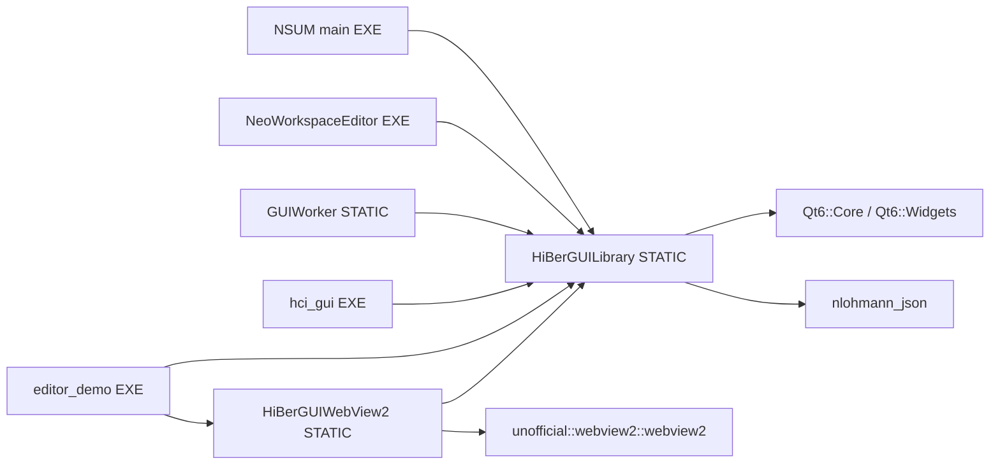

# HiBerGUILibrary module

## Overview

`HiBerGUILibrary` is the repository's in-house general-purpose GUI component library (the main target of the `modules/HiBerGUILibCPP` project, namespace `HiBerGUI`, LGPL-2.1). It contains only **business-agnostic** widgets: animated progress bars and card stacks, toast notifications, output and repository tree panels, the code editor suite, the merge preview dialog and the Git panel. The main application wizard, the workspace editor and the installer GUI shell all take components from here, so changing one component affects several products - this page describes its boundaries and coupling points.

`HiBerGUIWebView2`, in the same project, is the "GUI component library that depends on WebView2": today it contains only `WebCodeEditor` (implementing the same `ICodeEditor` interface). Only programs that link it pull in the WebView2 dependency; a program that uses `HiBerGUILibrary` alone has zero WebView2 dependency.

## Goals

- **Components decoupled from business**: components know nothing about workspace or modpack concepts; data enters and leaves through setters and Qt signals;
- **Zero-WebView2 baseline**: the base library depends only on Qt Core/Widgets plus nlohmann-json;
- **Theme adaptivity**: dark/light palettes restyle themselves on `palette()` and `ThemeChange` events;
- **Embeddable**: every panel is a plain `QWidget` that fits into any host layout as a child widget;
- **Interface-based editor**: the `ICodeEditor` abstraction makes the Qt and WebView2 implementations interchangeable; the host registers factories as needed.

## Boundaries

**What it does**

- Progress and feedback: `AnimatedProgress`, `ProgressCard`, `WorkCard`, `WorkCardStack`, `ToastNotification`;
- Trees and panels: `RepoTreePanel`, `OutputTreePanel`, `DeepTreeBehavior`;
- Code editing: `CodeEditor` (Qt implementation), the `ICodeEditor` / `ICodeHighlighter` extension points, `GitIgnoreHighlighter`, `FileContentEditor`, `MergePreviewDialog`;
- Git UI: `GitPanel` (status / staging / history / commit / push, fully asynchronous).

**What it does not do**

- No business rules (branch inheritance, sync policy, export format decisions all live in NeoWorkspace/NeoBuild/GUIWorker);
- No file persistence or git semantics - `GitPanel` only runs git through `QProcess` and shows the result;
- No WebView2 dependency (that is `HiBerGUIWebView2`'s job);
- No main window or wizard flow (owned by `GUIWorker` and the individual EXEs).

## Dependencies

| Dependency | Type | Purpose |
|---|---|---|
| `Qt6::Core` / `Qt6::Widgets` | Qt (PUBLIC) | base classes, painting, animation, QProcess for every component |
| `nlohmann_json::nlohmann_json` | third-party library (PUBLIC) | `OutputTreePanel` consumes JSON tree entries |
| `unofficial::webview2::webview2` | third-party library (`HiBerGUIWebView2` only, PRIVATE) | host for the web-based editor |
| `HiBerGUILibrary` | STATIC (PRIVATE dependency of `HiBerGUIWebView2`) | reuse the `ICodeEditor` interface and language definitions |

## Files

| File | Purpose |
|---|---|
| `HiBerGUILibrary/include/animated_progress.h` | smooth/indeterminate progress bar with a `setCompact` thin always-visible mode |
| `HiBerGUILibrary/include/toast_notification.h` | top-right error toast whose countdown pauses on hover |
| `HiBerGUILibrary/include/progress_card.h` | large repository-loading card (title / progress / cancel) |
| `HiBerGUILibrary/include/work_card.h`, `work_card_stack.h` | compact task card and stacked card deck (self-anchored to the host's top-right corner) |
| `HiBerGUILibrary/include/repo_tree_panel.h` | repository tree: inherited files, delete/override markers, pointer grouping, drag & drop / clipboard |
| `HiBerGUILibrary/include/output_tree_panel.h` | output tree: U/M/D entries, format combo, config markers, drop-target highlight |
| `HiBerGUILibrary/include/deep_tree_behavior.h` | tree expand/collapse behavior: triangle/double-click, expand one level, collapse deep |
| `HiBerGUILibrary/include/code_editor_interface.h` | `ICodeEditor`, `ICodeHighlighter`, language definitions, region highlights, factory registration |
| `HiBerGUILibrary/include/code_editor.h` | Qt editor implementation (line-number gutter, highlighting, toolbar actions) |
| `HiBerGUILibrary/include/gitignore_highlighter.h` | `.gitignore` marker syntax-highlighting driver |
| `HiBerGUILibrary/include/file_content_editor.h` | file content editing plus a save signal |
| `HiBerGUILibrary/include/merge_preview_dialog.h` | merge result preview dialog (Qt or Web editor) |
| `HiBerGUILibrary/include/git_panel.h` | Git panel: branch status, staging area, history, commit/push/pull (async) |
| `HiBerGUIWebView2/include/web_code_editor.h` | `WebCodeEditor`: WebView2 implementation of the same `ICodeEditor`, with a placeholder when the runtime is missing |
| `examples/` | component demo (`HIBERGUI_BUILD_EXAMPLES`) |

## Build integration

- Project: `modules/HiBerGUILibCPP/CMakeLists.txt` (`project(HiBerGUILibCPP)`, `CMAKE_AUTOMOC ON`, self-contained subdirectories `HiBerGUILibrary/` and `HiBerGUIWebView2/`);
- Targets and library type: both `HiBerGUILibrary` and `HiBerGUIWebView2` are **STATIC**; there is no executable artifact and no deploy step;
- Include directories: `HiBerGUILibrary/include` is exposed as `PUBLIC`; `HiBerGUIWebView2` additionally forwards the base library include as `PUBLIC`;
- Dependency discovery: `find_package(Qt6 COMPONENTS Core Widgets)`, `find_package(nlohmann_json CONFIG)` and `find_package(unofficial-webview2 CONFIG)` inside the project;
- The root `CMakeLists.txt` calls `add_subdirectory(modules/HiBerGUILibCPP)`; the library is linked by `GUIWorker` (PUBLIC), the main application, `NeoWorkspaceEditor`, `hci_gui` and `editor_demo`;
- `editor_demo` additionally copies `WebView2Loader.dll` and the `windeployqt` output into its own directory (demo-only, not part of the official release chain).

## Public symbols

| Symbol | Type | Description |
|---|---|---|
| `HiBerGUI::AnimatedProgress` | class | progress bar: `setValue`/`setIndeterminate`/`setText`/`setCompact`/`startAnimation`/`stopAnimation` |
| `HiBerGUI::ToastNotification` | class | `showError(title, detail, timeoutMs)`/`dismiss`/`setTopOffset` |
| `HiBerGUI::ProgressCard` | class | `showCard`/`setProgress`/`complete`/`fail`/`hideCard`/`isActive`, signal `cancelRequested` |
| `HiBerGUI::WorkCard` / `WorkCardStack` | class | compact task card and card stack (`addCard`/`removeCard`/`updateLayout`/`reposition`) |
| `HiBerGUI::RepoObjectType` / `RepoObjectInfo` | enum / struct | repository node type (Root/Folder/ConfigFile/PlainFile/Pointer) and node information |
| `HiBerGUI::RepoTreePanel` | class | `setRootPath`/`setPointerDir`/`setInheritedFiles`/`setBranchManifest`/`setPointerFiles`, several `*Requested` signals |
| `HiBerGUI::OutputTreePanel` | class | `loadEntries(entries, pointerRels)`/`setExtraConfigFiles`/`setFormat`, `formatChanged`/`deleteRequested` and similar signals |
| `HiBerGUI::DeepTreeBehavior` | class | expand/collapse behavior attached to a `QTreeWidget` (`toggleItem`) |
| `HiBerGUI::ICodeEditor` | interface | editor abstraction: language / text / read-only / line numbers / font size / Tab / theme / region highlights / actions |
| `HiBerGUI::ICodeHighlighter` | interface | external highlighter driver (`highlight(langId, text, spans)`) |
| `HiBerGUI::CodeEditor` | class | Qt editor implementation, signal `languageChanged` |
| `HiBerGUI::GitIgnoreHighlighter` | class | `.gitignore` marker highlighting |
| `HiBerGUI::FileContentEditor` | class | `loadContent(relPath, absPath, inherited, sourceAbs)` plus signal `contentSaveRequested` |
| `HiBerGUI::MergePreviewDialog` | class | `setContent(content, info, langId, highlights)` |
| `HiBerGUI::GitPanel` | class | `setRepoPath`/`setGitPath`/`refresh`/`softResetTo`/`squashDialog`, `gitOperationFinished` and similar signals |
| `HiBerGUI::WebCodeEditor` | class | WebView2 implementation of `ICodeEditor` (`usingWebView()` reports readiness) |
| `HiBerGUI::registerCodeEditorFactory` / `createCodeEditor` | function | register and create editors by `CodeEditorKind` (Qt/Web) |

## Related

- [usage.md](./usage.md)
- [Architecture overview](../../architecture/overview.md)
- [Editor extensions](../../../extensions/editor/index.md)
