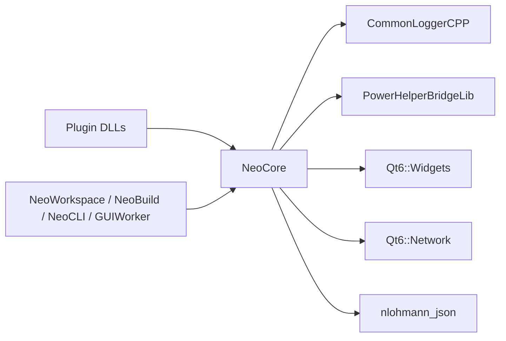

# NeoCore

## Overview

`NeoCore` is the foundation library of NSUM. It is a **STATIC** library that contains interfaces and cross-module utilities only: the three plugin interfaces (`IConfigParser`, `IPluginPointer`, `IModpackExporter`), the editor extension interfaces, `PluginLoader`, the UTF-8 path helpers (`fsu8`), `CancelToken`, error codes, the build progress contract (`IBuildProgress`) and the HTTP Range parallel downloader. Both engines (`NeoWorkspace` / `NeoBuild`), the CLI, the GUI layer and every plugin DLL link it, so this page is the contract all of them share.

## Goals

- Provide stable extension interfaces, so parser / pointer / exporter plugins never depend on the engines and can be built against this module alone;
- Centralise Windows path and encoding handling in one place, so no other module has to reason about ANSI versus UTF-8;
- Provide reusable download and cancellation infrastructure instead of letting each engine grow its own copy.

## Boundaries

**What it does**

- Defines `IConfigParser`, `IPluginPointer`, `IModpackExporter` and the editor extension interfaces `IConfigEditorExtension` / `IPointerEditorExtension`;
- Scans and loads parser DLLs through `PluginLoader` (`.meta.json` next to the DLL, `CreateParser` export);
- Provides `path_utf8.h` (`fsu8`), `CancelToken`, `error_codes.h`, `IBuildProgress` / `BuildResult` and `AnalyzeGitError`;
- Provides `ParallelDownloader`, which splits a download into HTTP Range chunks inside the Qt event loop.

**What it does not do**

- No build, sync or export business logic - that belongs to `NeoWorkspace` / `NeoBuild` / the exporter plugins;
- No GUI logic. `Qt6::Widgets` is linked only because the editor extension interfaces return `QWidget*` and exchange `QJsonObject`;
- Holds no global configuration. Runtime state is per instance (a loader, a token, an options struct), so several engines can coexist in one process.

## Dependencies

| Dependency | Type | Purpose |
|---|---|---|
| `CommonLoggerCPP` | STATIC, PUBLIC | logging facade `CLogger` reachable from the library and from plugin DLLs |
| `PowerHelperBridgeLib` | STATIC, PUBLIC | help-document bridge inherited by every consumer, so the GUI side needs no second link step |
| `Qt6::Widgets` | library, PUBLIC | editor extension interfaces (`QWidget*`, `QJsonObject`) |
| `Qt6::Network` | library, PUBLIC | `QUrl` / `QNetworkAccessManager` used by `ParallelDownloader` |
| `nlohmann_json::nlohmann_json` | header-only, PUBLIC | `PointerInfo::metadata`, `PointerFileData` JSON, exporter metadata |

## Files

| File | Purpose |
|---|---|
| `include/IConfigParser.h` | config parse/merge interface plus `TrackingMode`, `ParserCapability`, `ConfigEntry`, `LineEntry`, `CreateParserFunc` |
| `include/IPluginPointer.h` | pointer resolution interface, `PointerInfo`, `PointerFileData`, `IDownloadMethod` |
| `include/IModpackExporter.h` | export interface plus `ExportMetadata`, `BuildTarget`, `BuildResult` entry point |
| `include/IConfigEditorExtension.h` | editor extension for config formats (`createEditor` / `loadConfig` / `saveSyncRules` / `mergePreview`) |
| `include/IPointerEditorExtension.h` | editor extension for pointer resolver metadata |
| `include/PluginLoader.h` | parser DLL scan/load, `FindParser`, `ListParsers` |
| `include/parallel_downloader.h` | `ParallelDownloadOptions` / `ParallelDownloadResult` / `ParallelDownloader` |
| `include/path_utf8.h` | `fsu8` UTF-8 path helpers |
| `include/cancel_token.h` | `CancelToken` |
| `include/error_codes.h` | `ErrorCode` enumeration and `ErrorCodeToString` |
| `include/IBuildProgress.h` | `BuildProgress`, `BuildResult`, `IBuildProgress` |
| `include/git_analyzer.h` | `AnalyzeGitError` (turns git stderr into a readable cause) |
| `src/plugin_loader.cpp` | meta/DLL pairing, `CreateParser` lookup, plugin log sink injection |
| `src/parallel_downloader.cpp` | Range probe, preallocation, concurrent chunk writes, progress aggregation |
| `src/error_codes.cpp` / `src/git_analyzer.cpp` | error strings and git-stderr analysis |
| `src/cancel_token.cpp` | empty translation unit that keeps the header-only `CancelToken` in the target's source list |

## Build integration

- target: `NeoCore`, library type **STATIC** (`add_library(NeoCore STATIC src/plugin_loader.cpp src/cancel_token.cpp src/git_analyzer.cpp src/error_codes.cpp src/parallel_downloader.cpp)`);
- include directory: `modules/NeoCore/include`, exposed as **PUBLIC**; the five dependencies above are linked **PUBLIC**, so consumers inherit them and do not repeat `find_package`;
- consumed **PUBLIC** by `NeoWorkspace`, `NeoBuild`, `NeoCLI` and `GUIWorker`, and **PRIVATE** by the main executable and by every plugin DLL (`NeoParser_*`, `NeoPointer_*`, `NeoExporter_*`, `NeoEditorExtension_*`);
- being static it produces no deploy artifact of its own; the plugin ABI is whatever the headers in `include/` declare.

## Public symbols

| Symbol | Type | Description |
|---|---|---|
| `IConfigParser` | interface | config parse / merge, optional line-level tracking |
| `IPluginPointer` | interface | pointer URL resolution and file validation |
| `IModpackExporter` | interface | exporter entry: `build_modpack` / `export_modpack` / `preview_structure` |
| `IConfigEditorExtension` / `IPointerEditorExtension` | interface | editor-side extension contracts |
| `PluginLoader` | class | scans a parser directory, maps a file path to a parser |
| `CancelToken` | class | cooperative cancellation (`request_cancel` / `is_cancelled` / `reset`) |
| `ParallelDownloader` | class | HTTP Range chunk download inside the Qt event loop |
| `fsu8` | namespace (global) | UTF-8 path helpers `path` / `exists` / `is_directory` |
| `IBuildProgress` | interface | main/sub progress bars and log lines, injected into the build engine |
| `BuildResult` | struct | `success`, `outputDir`, `errorMessage`, `warnings`, file counters |
| `ErrorCode` | enum | numbered error space (`GitTimeout` 1001 ... `Cancelled` 9000, `Unknown` 9999) |
| `AnalyzeGitError` | function | `std::string AnalyzeGitError(const std::string& stderrOutput)` |

## Related

- [usage.md](./usage.md)
- [Plugin contracts](../../framework/plugin-contracts.md)
