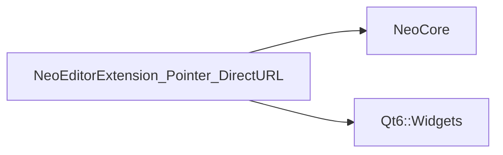

# NeoEditorExtension_Pointer_DirectURL

## Overview

`NeoEditorExtension_Pointer_DirectURL` is an editor extension (SHARED) implementing `NeoCore::IPointerEditorExtension`, providing editing/validation for `direct_url` pointers.

## Goals

- Let authors edit safely in the GUI instead of hand-writing JSON;
- Pair with the runtime plugin (merge/resolve);
- Depend only on editor interfaces.

## Boundaries

**Does**: create editor widgets, parse/serialize, validate input.
**Does not**: sync/download (runtime plugins).

## Dependencies

## Files

| File | Purpose |
|---|---|
| `src/` | Implementation and `CreateEditorExtension` |
| `NeoEditorExtension_Pointer_DirectURL.meta.json` | Capability declaration |
| `CMakeLists.txt` | SHARED target |

## Build integration

- target `NeoEditorExtension_Pointer_DirectURL` (SHARED);
- copied to `editor/extension/pointers/`;
- scanned/registered at editor startup.

## Public symbols

| Symbol | Description |
|---|---|
| `CreateEditorExtension` | Factory (`__declspec(dllexport)`) |
| `IPointerEditorExtension` impl | createEditor/... |

## Related

- [usage.md](./usage.md)
- [Editor extensions](../../../extensions/editor/index.md)