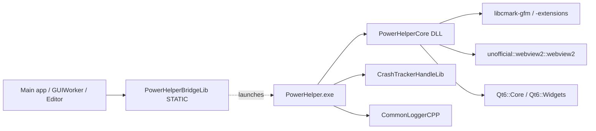

# PowerHelper module

## Overview

`PowerHelper` (a git submodule of the standalone `PowerHelper` repository, LGPL-2.1) is the documentation reader: it renders Markdown to HTML (WebView2) or to a `QTextDocument` (Qt fallback), provides a table of contents (TOC) and navigation between sibling `.md` files, and can render an ANSI version in the terminal. The same project produces three artifacts:

1. `PowerHelperCore` - the reader core (renderer + embeddable view + document group scanning);
2. `PowerHelperBridgeLib` - the integration library (`PowerHelper::Bridge`) that lets a host locate and launch the shell EXE;
3. `PowerHelper` - the shell EXE (GUI reader plus the `render`/`toc`/`group` CLI).

The NSUM main application, the workspace editor and GUIWorker expose an "open help documentation" entry point through `PowerHelperBridgeLib`, which reaches them through `NeoCore`'s PUBLIC link chain.

## Goals

- **Real HTML rendering**: tables, images and relative links render through WebView2, avoiding the table/layout weaknesses of `QTextBrowser`;
- **No crash without the runtime**: when the WebView2 runtime is missing (or initialization fails) it automatically falls back to the Qt rendering path - degraded but usable;
- **Reusable rendering**: the same Markdown source produces HTML, `QTextDocument` and ANSI terminal output;
- **Host decoupling**: a host depends only on `PowerHelperBridgeLib` (not on the core, not on WebView2) and opens documents by launching the standalone EXE;
- **Scriptable**: the `render` / `toc` / `group` subcommands output text or JSON so scripts and AI agents can read document structure.

## Boundaries

**What it does**

- Rendering: `renderToHtml`, `renderToDocument`, `renderToTerminal`, `extractToc`, `displayWidth`, `expandTabs`, `anchorName`;
- View: `MarkdownViewer` (embeddable widget, WebView2 plus Qt fallback, TOC navigation, relative-link signal);
- Document groups: `scanDocGroup(dir)` recursively scans `.md` files and fills in titles and TOCs;
- Bridge: `findPowerHelperExe`, `launchReader`, `defaultDocsDir`, `classifyTarget`;
- Shell: GUI reader window (outline tree + view + anchor navigation), three CLI subcommands, crash handling and logging integration.

**What it does not do**

- No Markdown editing (read-only reader);
- No site generation or publishing (`tools/build_docs.ps1` is a different pipeline);
- No full-text search index and no PDF/Office conversion;
- It does not bring the WebView2 dependency into hosts - only the shell EXE and programs linking `PowerHelperCore` need it.

## Dependencies

| Dependency | Type | Purpose |
|---|---|---|
| `Qt6::Core` / `Qt6::Widgets` | Qt (PUBLIC) | rendering to `QTextDocument`, the view widget, the shell window |
| `libcmark-gfm` / `libcmark-gfm-extensions` | third-party libraries (PUBLIC, `PowerHelperCore`) | CommonMark + GFM (tables, strikethrough, autolinks, task lists) parsing |
| `unofficial::webview2::webview2` | third-party library (PUBLIC, WIN32) | HTML rendering host |
| `spdlog` (through `CommonLoggerCPP`) | third-party library | shell logging |
| `CrashTrackerHandleLib` | STATIC (PRIVATE, shell) | shell crash backstop |
| `cmark-gfm` `find_package` | CMake dependency | `find_package(cmark-gfm REQUIRED)` / `find_package(cmark-gfm-extensions REQUIRED)`; target names are `libcmark-gfm*` (no namespace) |

## Files

| File | Purpose |
|---|---|
| `core/include/markdown_renderer.h` | rendering API: HTML / QTextDocument / ANSI / TOC / width helpers (`PH_API` exports) |
| `core/include/markdown_viewer.h` | `MarkdownViewer`: WebView2 view plus Qt fallback, `toc()`/`scrollToHeading`/`openFileRequested` |
| `core/include/doc_group.h` | `DocFileInfo` and `scanDocGroup` |
| `core/include/powerhelper_export.h` | `PH_API` export macro (empty under `POWERHELPER_STATIC`) |
| `bridge/include/powerhelper_bridge.h` | the four `PowerHelper::Bridge` functions |
| `app/main.cpp` | entry: CLI dispatch, GUI window, console hold/release, crash handler |
| `app/reader_window.cpp` | reader window: outline tree, view, link navigation, anchors |
| `app/powerhelper_cli.cpp` | `render` / `toc` / `group` subcommands (with `--json`) |
| `test/render_test.cpp` | manual renderer test (`ph_rendertest`, `EXCLUDE_FROM_ALL`) |
| `resources/version.rc.in`, `PR.ico` | version resource template and icon |

## Build integration

- targets and library types (`modules/PowerHelper/CMakeLists.txt`):

| target | Type | Description |
|---|---|---|
| `PowerHelperCore` | **SHARED** (default); STATIC with `POWERHELPER_STANDALONE_ONLY=ON`, which also defines `POWERHELPER_STATIC` | renderer + view; the export macro follows the linkage mode |
| `PowerHelperBridgeLib` | **STATIC** | host-side bridge (`PowerHelper::Bridge`), independent of the core |
| `PowerHelper` | **EXE** (console subsystem; GUI mode keeps or releases the terminal itself) | reader shell |
| `ph_rendertest` | EXE (`EXCLUDE_FROM_ALL`) | manual renderer test, not part of the default build |

- dependency submodules: when `TARGET CrashTrackerHandleLib` / `TARGET CommonLoggerCPP` does not exist it pulls them in with `add_subdirectory` (skipped when the host already provides them);
- deployment: a POST_BUILD step of `PowerHelper` copies `PowerHelperCore.dll` and `libcmark-gfm*.dll` next to itself and runs `windeployqt` (`--no-translations --no-opengl-sw --no-compiler-runtime --no-system-d3d-compiler`); the root `neo_deploy` then copies `PowerHelper.exe` + `PowerHelperCore.dll` into `deploy/` and runs `windeployqt` on `deploy/PowerHelper.exe`;
- bridge chain: `NeoCore` links `PowerHelperBridgeLib` **PUBLIC**, so the main application, the editor and GUIWorker can call `PowerHelper::Bridge::*` without adding anything explicitly;
- standalone release: `POWERHELPER_STANDALONE_ONLY=ON` switches to the static-Qt single-file EXE mode (the standalone PowerHelper repository ships the matching preset); in this repository no preset sets it, so the default shared build is used.

## Public symbols

| Symbol | Type | Description |
|---|---|---|
| `PowerHelper::renderToHtml` | function (`PH_API`) | Markdown -> HTML (CommonMark + GFM) |
| `PowerHelper::renderToTerminal` | function | Markdown -> ANSI terminal text (colors / CJK widths / table alignment) |
| `PowerHelper::renderToDocument` | function | Markdown -> `QTextDocument` (optional dark mode, headings carry `ph-n` anchors) |
| `PowerHelper::extractToc` | function | extracts the heading outline with `level >= 1` |
| `PowerHelper::displayWidth` / `expandTabs` / `anchorName` | function | CJK display width, tab expansion, `ph-<index>` anchor names |
| `PowerHelper::TocEntry` | struct | `level` + `text` |
| `PowerHelper::MarkdownViewer` | class (QWidget) | `setMarkdown`/`loadFile`/`toc`/`scrollToHeading`/`scrollToHeadingText`/`usingWebView` |
| `PowerHelper::DocFileInfo` | struct | `relPath`/`absPath`/`title`/`toc` |
| `PowerHelper::scanDocGroup` | function | recursively scans `.md` files in a directory and fills titles and TOCs |
| `PowerHelper::Bridge::findPowerHelperExe` | function | locates the shell (`PowerHelper.exe` next to the current exe) |
| `PowerHelper::Bridge::launchReader` | function | launches the standalone reader (file or directory, with extra arguments) |
| `PowerHelper::Bridge::defaultDocsDir` | function | default document group directory = `docs` next to the current exe |
| `PowerHelper::Bridge::classifyTarget` / `TargetKind` | function / enum | `File` / `Dir` / `Unknown` classification |

## Related

- [usage.md](./usage.md)
- [Architecture overview](../../architecture/overview.md)
- [User documentation: troubleshooting](../../../user/troubleshooting.md)
