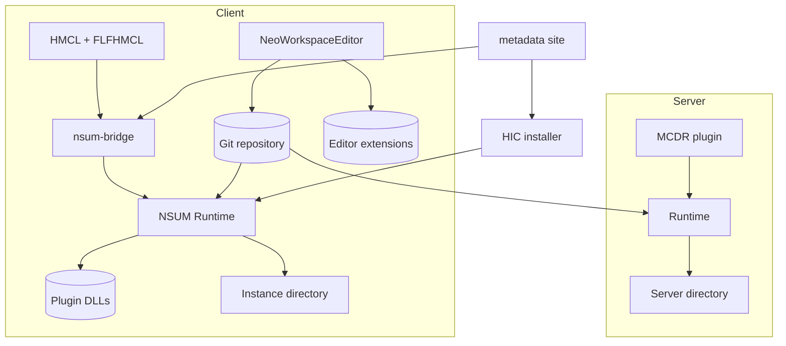
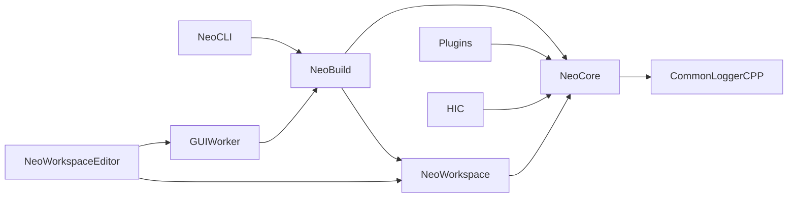

# Overview

NSUM is composed of several processes/components working around one Git repository.

## Components

| Component | Form | Responsibility |
|---|---|---|
| NSUM Runtime | `NeoServerUpdateModpack.exe` + `deploy/` | Build, sync, export, downloads, CLI |
| GUI | same EXE (no args) | Wizard/build pages |
| CLI | same EXE (`info/flow/exec`) | Headless operations and JSON |
| nsum-bridge | HMCL extension jar | NSUM page, launch injection, Runtime install |
| HIC installer | standalone EXE | Install Runtime/Editor, bundled Git |
| NeoWorkspaceEditor | standalone EXE | Repository content editor + CLI |
| MCDR plugin | Python plugin | Server core install/sync |
| Plugin DLLs | `parsers/pointers/exporters/editor/extension` | Parsing, downloads, export, editing |

## Processes and data flow

## Module layers

- **NeoCore**: interfaces, PluginLoader, paths, parallel downloader;
- **NeoWorkspace**: workspace.json, branches, Git operations, sync policies;
- **NeoBuild**: build engine, branch merge, pointer download, serverconfig, exporter loading;
- **NeoCLI/GUIWorker**: CLI and GUI domain layers;
- **Plugins**: loaded as DLLs at runtime.

## Data directories

| Directory | Content |
|---|---|
| `.hmcl/nsum/runtime/` | Runtime |
| `.hmcl/nsum/repos/` | Cloned repositories |
| `.hmcl/nsum/cache/files/` | Embedded file cache (SHA-256) |
| `.minecraft/versions/.cache/` | Build-side pointer cache (SHA-256) |
| `config/history/` | GUI history and remote cache |

## Key constraints

- Runtime does not depend on system Git (bundled MinGit);
- Plugins interact via exported symbols; cross-DLL STL/Qt passing is constrained (see [ABI](../framework/abi.md));
- All paths are UTF-8 (Windows argv rebuilt);
- Sync failure aborts launch by default.

## Related

- [Design goals](./design-goals.md)
- [Data model](./data-model.md)
