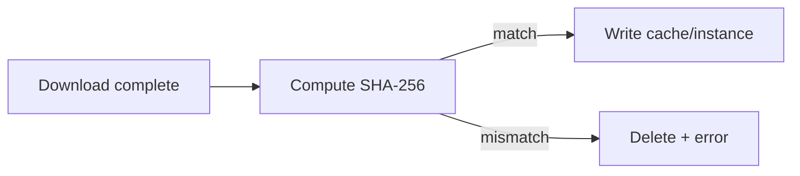

# Security

NSUM handles repositories, mods and installers from the network; security boundaries must be explicit.

## Threat model

| Threat | Mitigation |
|---|---|
| Tampered downloads | SHA-256 verification (pointers/embedded/metadata) |
| Path traversal | Repository/instance-relative paths, `..` rejected |
| Encoding confusion | UTF-8 end-to-end (argv/exeDir/QProcess) |
| Accidental instance deletion | Mirror deletion protection list |
| Credential leakage | No tokens in logs; git prompt disabled |
| Supply chain | Package SHA-256 + GitHub Release + metadata |

## Path rules

- CLI `--repo` and editor paths stay inside the repository;
- Assets/docs never write outside the repository;
- `file_manifest` uses `/` (`generic_u8string`);
- Windows non-ASCII paths go through `fsu8`.

## Content verification

- Embedded files use `embedded[]` sha256;
- Pointers use the `sha256` field;
- Runtime packages use metadata `sha_256`.

## Credentials

- Git operations set `GIT_TERMINAL_PROMPT=0` / `GCM_INTERACTIVE=never`;
- Never log tokens or write them into docs;
- Private repos use the system credential manager; no built-in accounts.

## Release chain

1. Build the package zip;
2. Upload with `gh release`;
3. Record `sha_256`/`size_bytes` in metadata;
4. Clients verify SHA-256 after download.

## Limitations

- Author identity is not verified (relies on GitHub accounts);
- Jars/mods are not signed;
- Player local edits are not blocked (zero trust covers content consistency only).

## Related

- [Design goals](./design-goals.md)
- [Release](../release.md)
