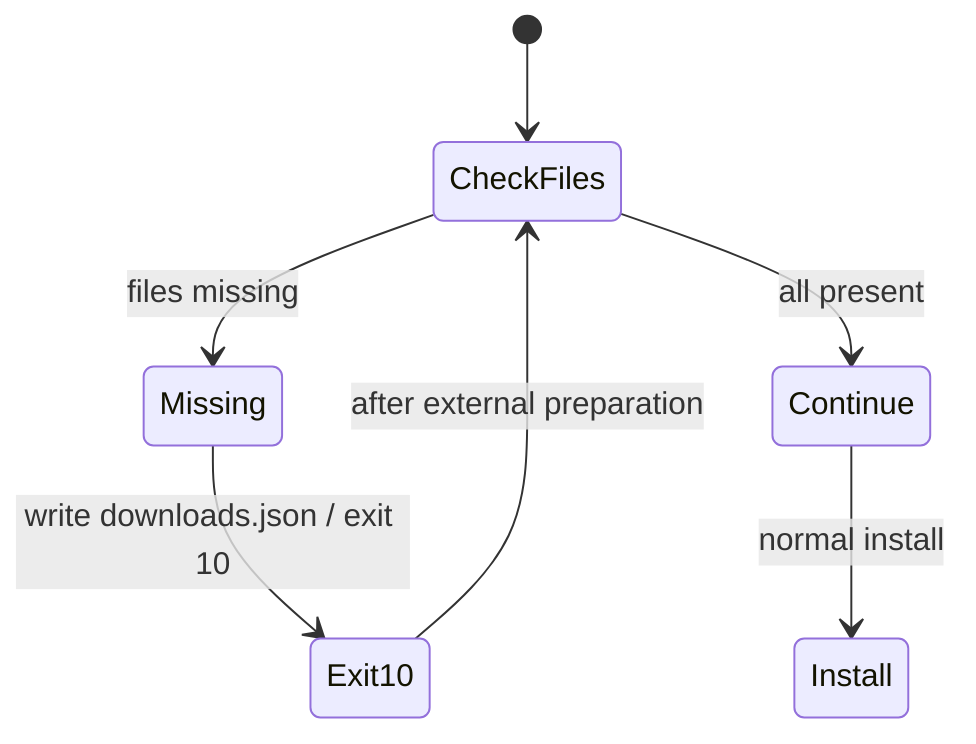

# External Download Mode

For restricted networks/offline installs: the installer does **not download**; it lists required files so an external tool can prepare them.

## Contract

```powershell
hci_cli.exe --external-download <dir> --silent --cli
```

1. Each `download` step first checks `<dir>/files/<name>` exists with matching size;
2. Missing files are written to `<dir>/downloads.json`;
3. The flow returns **2** and the CLI exits **10**;
4. After `<dir>/files/*` is prepared, re-run the same command.

## downloads.json

```json
{
  "downloads": [
    { "name": "deploy.zip", "url": "https://example.com/deploy.zip", "size": 53083322, "sha256": "..." }
  ]
}
```

## State machine



## Notes

- The pause must bypass step `optional` (never continue silently);
- JSON mode emits an `hci/downloads-required` block;
- File names must match the manifest;
- Size mismatches count as missing.

## Related

- [CLI](./cli.md)
- [Flow scripts](./flow.md)
