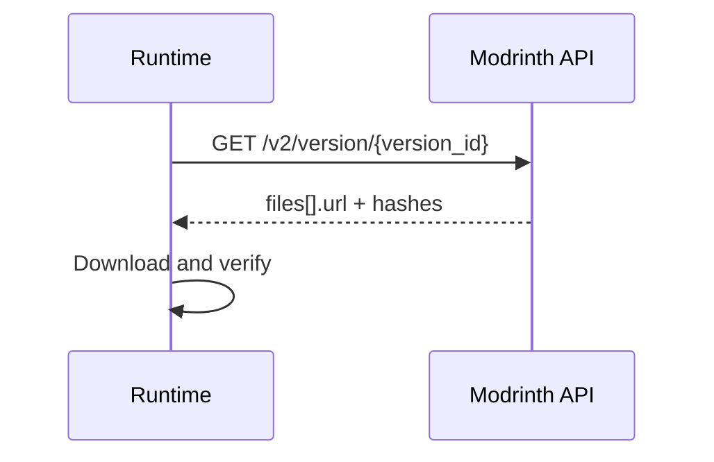

# Modrinth Resolver

`NeoPointer_Modrinth` turns project/version identifiers into official download URLs.

## Capability

| Item | Value |
|---|---|
| resolver | `modrinth` |
| metadata | `project_id` (required), `version_id` (recommended) |
| API | `https://api.modrinth.com/v2` |

## Pointer

```json
{
  "resolver": "modrinth",
  "metadata": { "project_id": "fabric-api", "version_id": "0.92.2+1.20.1" },
  "sha256": "<64 hex>",
  "size": 123456
}
```

- With `version_id`: resolve that exact version;
- With only `project_id`: latest version (not recommended; content drifts).

## Create

```powershell
NeoWorkspaceEditor.exe exec pointer-add --path mods/fabric-api.jar --sha256 <64-hex> `
    --resolver modrinth `
    --metadata-json '{"project_id":"fabric-api","version_id":"0.92.2+1.20.1"}' `
    --branch base --repo <repository>
```

## Resolution



## Limitations

- Requires API access;
- Deleted/hidden versions cannot be resolved;
- CurseForge is not supported.

## Related

- [Pointer resolvers](./index.md)
- [Pointers (author)](../../pack-author/pointers.md)
