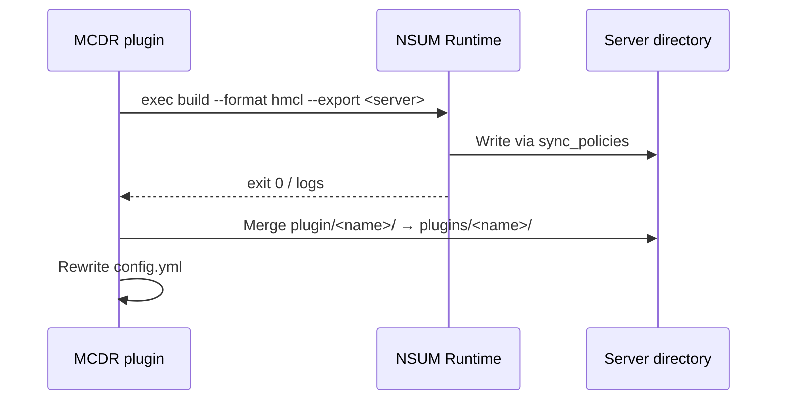

# Server Sync

## Flow



## Command

```powershell
NeoServerUpdateModpack.exe exec build --repo <repository> --modpack server --git-branch main `
    --repo-preference auto --format hmcl --export <server directory>
```

- `--repo-preference` / `--repo-timeout` come from the plugin's `repo_preference` / `repo_timeout_seconds`;
- `timeout_seconds` (default 1800s) is the total sync timeout; the Runtime is terminated and startup is blocked on expiry.

## Plugin merge

Repository layout:

```text
plugin/MyPlugin/
├─ plugin.yml
└─ ...
```

After sync it is merged into `plugins/MyPlugin/` and the intermediate directory is deleted.

## Protection

- `mirror` protects server runtime files (`logs/`, `world*`, `server.properties`, per policy);
- Prefer `incremental_add`/`incremental_overwrite` on servers to avoid deleting saves;
- Stop the server or use `save-off`/`save-all` before syncing.

## Troubleshooting

| Symptom | Cause | Fix |
|---|---|---|
| Server won't start after sync | Core/plugin version mismatch | Check logs and core config |
| Duplicate plugins | Both `plugins/` and `plugin/` exist | Keep only one layout |
| Config overwritten | `full` policy | Use `partial` to preserve local keys |

## Related

- [Config](./config.md)
- [Sync rules](../../pack-author/sync-rules.md)
