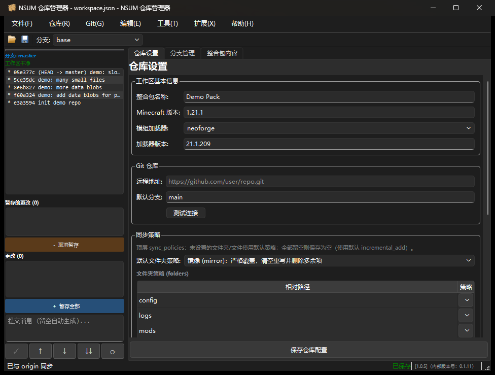
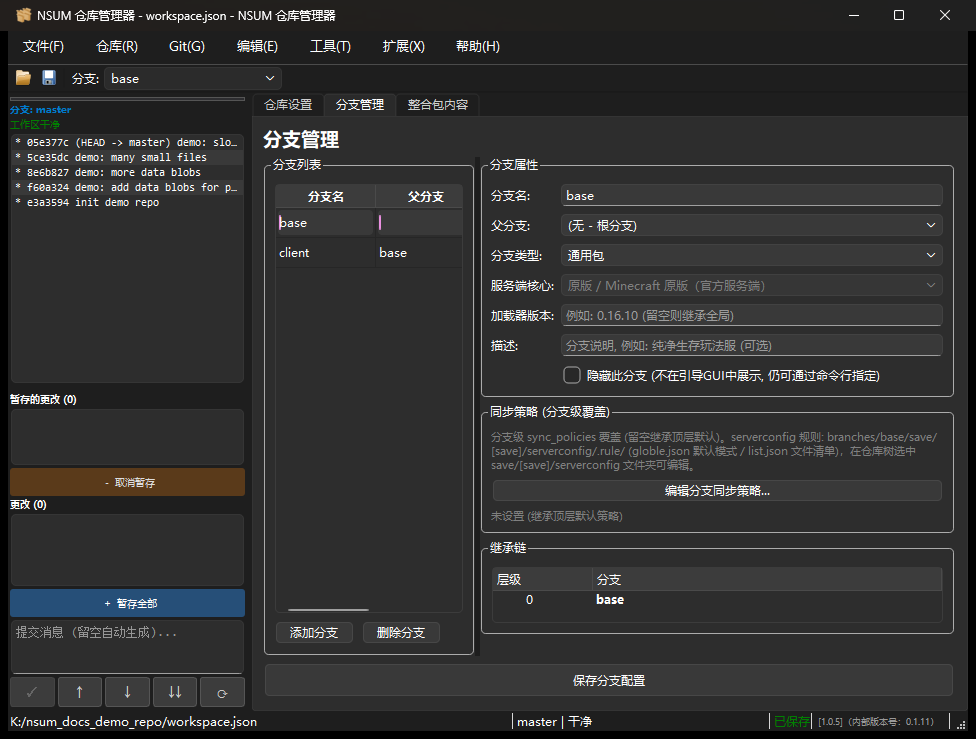
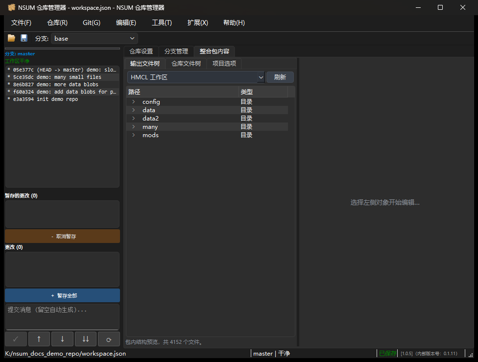

# Editor UI








`NeoWorkspaceEditor.exe` is a modpack content IDE: edit repository config and content, then commit changes with Git.

## Open a repository

```powershell
NeoWorkspaceEditor.exe <repository directory>
NeoWorkspaceEditor.exe <repository directory>\workspace.json
```

After launch it loads `workspace.json`; the Git panel is on the left and three tabs on the right.

## Tabs

> Since 1.0.6 multiple repository URLs are supported; older `workspace.json` files (`version: 1.0`, only `git.remote`) still open and are upgraded to `1.1` on save.

### 1. Repository settings

- Workspace name, Minecraft version, loader and version;
- Three repository URL fields (SSH / HTTPS / HTTP) plus a primary URL (`git.remote`, since 1.0.6);
- The main program (not the Editor) repository page has an **Address priority** selector (auto fastest / prefer SSH / HTTPS / HTTP, since 1.0.7); a failed clone or 60s timeout tries the next address; inside the Editor, the primary selector and three URL fields remain the manual controls;
- Saving writes `git.remotes[]` (`ssh`/`https`/`http`, primary first) and upgrades `version` to `1.1`;
- Default branch;
- Default export metadata (name/version/author/description);
- Saving writes back to `workspace.json`.

### 2. Branch management

- Table of all modpack branches (name/parent);
- Create, delete, rename branches;
- Branch properties: type (universal/client/server), server core, loader version, description, hidden;
- Per-branch sync policies and serverconfig/custom_mods entries;
- Saving updates `workspace.json` and maintains `branch_config/<branch>.json`.

### 3. Modpack content

Dual-tree view:

| Tree | Content |
|---|---|
| Repository tree | Real files (`branches/<branch>/…`) |
| Output tree | Build preview (merged final content) |

- Double-click: config files open the code editor (JSON/YAML/TOML/SNBT/TXT/Properties); other types are routed by type;
- Drag & drop: writes into the repository at the drop target (plain/config/pointer conversion);
- Context menu: new/delete/rename, convert to pointer, create serverconfig folder;
- Root nodes show sync policy and branch info.

## Git panel

| Action | Description |
|---|---|
| Refresh | Asynchronously refresh status and history |
| Stage/unstage | Single file or all |
| Commit | Optional auto-stage; message required |
| Pull/push/fetch | Uses bundled or system Git |
| Revert/reset | Destructive, guarded by confirmation |

Run validation before committing.

## Pointer editor

- View/edit `branch_config/<sha>.pointer`;
- Configure resolver (direct_url / Modrinth) and metadata;
- Convert large files to pointers (compute SHA-256, move to cache, update `file_manifest`);
- Converting back downloads and verifies via the resolver.

## serverconfig folder

- Right-click the root node → "Create serverconfig sync folder";
- Creates `branches/<branch>/save/[save]/serverconfig/` and default `.rule`;
- Stages the folder with Git so empty directories are not lost.

## Extension menu

The editor loads extension DLLs from `editor/extension/`:

- Config parser extensions (JSON/YAML/TOML/SNBT/TXT/Properties);
- Pointer resolver extensions (Modrinth/DirectURL);
- The registry scans at startup; menus/editors appear dynamically.

## Help and docs

- "Help → Documentation" opens docs under `exe/docs` (rendered by PowerHelper);
- When the installer ticks Editor, the pack-author docs are released.

## Common actions

| Goal | Action |
|---|---|
| Add a client branch | Branch management → New → client type → choose parent |
| Add mods | Content tab → drop into `mods/` or import |
| Convert a mod to a pointer | Right-click → Convert to pointer |
| Change sync policy | Branch management/policy editor |
| Commit | Git panel → stage → message → commit |
