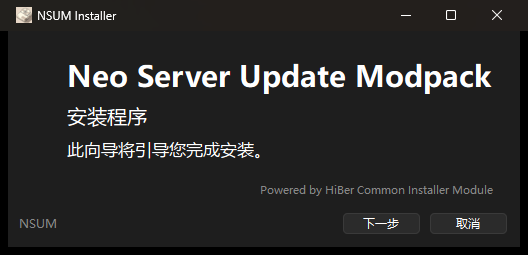

# Installation

## Address selection

Since 1.0.7, when a `.nsumpack` carries multiple repository URLs the runtime **probes them and picks the lowest-latency address**; a single address that times out or fails **automatically falls back to the next one**. SSH / HTTPS / HTTP addresses stay in the pack, so clients choose according to their own network without repacking.

| Mode | Behavior | How to set |
|---|---|---|
| Auto fastest (default) | Probe each address with `git ls-remote`, prefer the lowest latency, fall back on failure/timeout | `--repo-preference auto`; **Address priority: auto fastest** in the main program |
| Prefer protocol | Prefer the chosen SSH / HTTPS / HTTP address, then fall back | `--repo-preference ssh\|https\|http`; GUI selector |
| Manual | Use only the given URL, no probing or switching | `--repo-preference manual`, or enter a full URL |
| Bridge | Follow `preference` in `.hmcl/nsum/repo.properties` | See [Client bridge](https://github.com/HiBer2007/NeoServerUpdateModpack/blob/main/docs/en/1.0.7/extensions/client-bridge/index.md) |

Default timeouts: 8s probe, 120s clone (60s in the main GUI), 300s bridge sync. Adjust with `--repo-timeout <seconds>` or `repo.properties`; only when every address fails does the command report an error, and the log lists each probe latency and failure reason.



On the client, NSUM consists of **HMCL**, **nsum-bridge** (an HMCL extension) and **NSUM Runtime** (the sync engine). The Editor is optional and only needed by pack authors.

## Option 1: automatic install inside HMCL (recommended)

1. Install the FLFHMCL runtime (Fabric injection layer); see the FLFHMCL docs.

> **SSH repositories (since 1.0.6)**: for a `git@…` URL, click **SSH Key...** next to the repository input (or run `exec git-ssh-key --generate`) to create/select a key; the app sets `GIT_SSH_COMMAND` for bundled Git automatically.

> **FLFHMCL docs**: installation steps, system requirements and the HMCL compatibility matrix: [FLFHMCL installation guide](https://github.com/HiBer2007/FLFHMCL/blob/docs/bilingual/docs/en/users/flfhmcl/install.mdx).

2. Put `nsum-bridge-<version>.jar` into the `mods/` folder of your HMCL working directory.
3. Start HMCL; the **NSUM** page appears in the left sidebar.
4. On the NSUM page click "Install / Update Runtime". bridge downloads the latest Runtime package from the metadata site into:

```text
<HMCL working directory>/.hmcl/nsum/runtime/
```

5. The page shows the installed Runtime version; accept the prompt when an update is available.

## Option 2: standalone installer

If the server provides `NSUM_Installer_<version>.exe`:

1. Run the installer and choose the install directory;
2. Optionally tick "Editor" — **this is what releases the pack-author documentation**;
3. The installer downloads bundled Git (MinGit) and writes `install.conf`; the runtime does not depend on system Git;
4. The result contains `NeoServerUpdateModpack.exe` and a `deploy/` tree (or the install directory itself is the deploy root).

## Option 3: portable deploy

Extract `NSUM_Runtime_<version>.zip` anywhere; the folder containing `NeoServerUpdateModpack.exe` is the runtime root. Install/update bundled Git with:

```powershell
.\NeoServerUpdateModpack.exe exec git-update
```

## Verify

```powershell
# Version (full version looks like 1.0.5.0.1.11)
.\NeoServerUpdateModpack.exe info version

# Git source (bundled means bundled Git is usable)
.\NeoServerUpdateModpack.exe info git
```

In HMCL:

- the NSUM page shows the Runtime version and the install/update button;
- importing a `.nsumpack` recognizes the **NSUM modpack** type.

## Directories

| Path | Content |
|---|---|
| `.hmcl/nsum/runtime/` | Runtime deployment |
| `.hmcl/nsum/downloads/` | Runtime package download cache |
| `.hmcl/nsum/repos/` | Cloned/created NSUM repositories |
| `.hmcl/nsum/logs/` | bridge sync logs |
| `.hmcl/nsum/cache/files/` | SHA-256 cache for embedded pack files |

## Uninstall

- HMCL route: remove `mods/nsum-bridge-*.jar` and optionally `.hmcl/nsum/` (keep `repos/` if you want);
- Installer route: use "Apps & features" or the installer's uninstall flow.

## Common installation issues

| Symptom | Cause | Fix |
|---|---|---|
| NSUM page says Runtime is not installed | Only bridge was installed | Click "Install Runtime" on the NSUM page |
| Install stuck at 0 B/s | Network/proxy stalls large downloads | Retry, or download the zip manually into `.hmcl/nsum/downloads/` and use "Install from downloads" |
| SHA-256 mismatch | Incomplete or tampered download | Delete the file and retry |
| `git` unavailable | Bundled Git missing and no system Git | Run `exec git-update` or check `install.conf` |
## FLF ecosystem repositories

| Project | Description | Links |
|---|---|---|
| FLFHMCL | Fabric runtime for HMCL (Agent + Fabric Loader) | [GitHub](https://github.com/HiBer2007/FLFHMCL) · [Docs](https://github.com/HiBer2007/FLFHMCL/blob/docs/bilingual/docs/en/users/flfhmcl/index.mdx) |
| FLF API | Fabric-API-style extension layer for HMCL (events/registries/UI/accounts/downloads/modpacks) | [GitHub](https://github.com/HiBer2007/FLFAPI) · [Docs](https://github.com/HiBer2007/FLFAPI/blob/main/docs/en/index.mdx) |
| FLFHMCLauncher | Shell/high-level entry for FLFHMCL (environment, quick launch, version isolation, cache) | [GitHub](https://github.com/HiBer2007/FLFHMCLauncher) |
