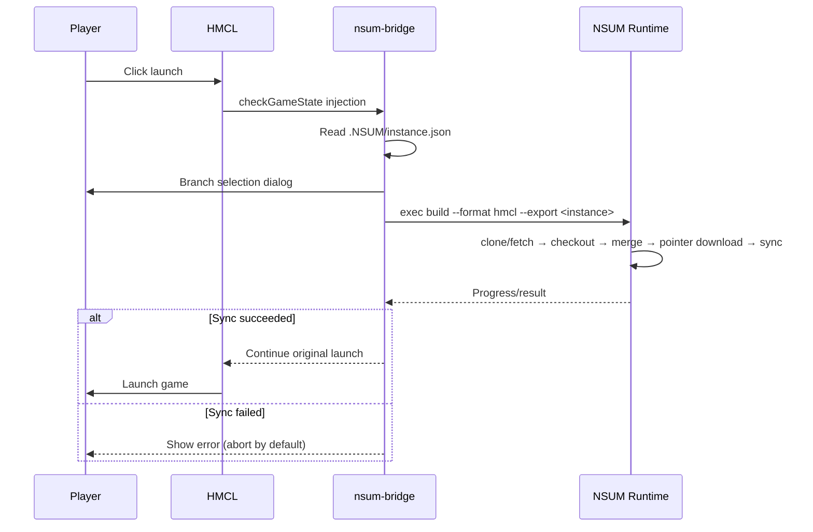

# Sync and Launch

Launching an NSUM instance does not start the game directly: HMCL first runs a **Runtime sync**, and only continues when it succeeds.

## Sequence



## Injection point

bridge injects the sync task into HMCL's launch check phase:

- wraps `LauncherHelper.checkGameState` via Mixin;
- task chain: `NSumSyncTask` (NSUM update check) → original launch flow;
- progress is shown in the HMCL task dialog and can be cancelled.

## Branch selection

On first launch/first sync there is a three-step selection (inside the task dialog, not a separate window):

1. Git branch (`git_branch`);
2. Modpack branch (`branch`);
3. Confirm.

The choice is stored in `<instance>/.NSUM/instance.json` and reused; read-only/single candidates are skipped.

## What the sync does

1. Clone or fetch the repository (`.hmcl/nsum/repos/`);
2. Checkout the Git branch and fast-forward to upstream;
3. Merge parent branches for the modpack branch;
4. Resolve pointers, download missing files by SHA-256 and verify;
5. Apply `sync_policies` and file markers (delete/override);
6. Write the instance directory (HMCL format).

## Failure policy

| Case | Default behavior |
|---|---|
| Network/download failure | Sync fails, launch aborts, error shown |
| `launchOnSyncFailure=true` | Launch with stale content (not recommended) |
| User cancels | Sync and launch abort |

After a failure, check the latest log in `.hmcl/nsum/logs/`.

## MCLHR integration

After a successful sync, bridge projects the mod store with MCLHR:

```text
java -jar <runtime>/tools/mclhr/mclhr.jar mc mods sync --instance <instance> --mode link --prune
```

- Uses hard links (copies fallback across volumes);
- Does not put mods on the classpath;
- Deduplicates by content.

## FLFHMCL

The launcher injection layer (FLFHMCL) behavior is described in its own docs.

> **FLFHMCL docs**: Agent launch flow, Early Display and instance selection: [FLFHMCL first launch](https://github.com/HiBer2007/FLFHMCL/blob/docs/bilingual/docs/en/users/flfhmcl/first-launch.mdx).

## Related

- [Quick start](./quick-start.md)
- [Troubleshooting](./troubleshooting.md)
