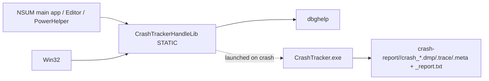

# CrashTrackerHandleLib module

## Overview

`CrashTrackerHandleLib` (namespace `HiBerCTM`, a standalone-repository submodule) is the **in-process crash backstop** of every EXE: it installs an unhandled-exception filter, writes a minidump, a call stack and metadata into `<exe>/crash-report/<timestamp>/` when the process crashes, and then launches the `CrashTracker.exe` sitting next to it to produce a readable report.

It solves a very real problem: after a GUI crash the user can only say "it just closed". With this layer the crash site leaves a `.dmp`/`.trace`/`.meta` triple that can be reproduced and analyzed; in Debug builds even CRT heap asserts (`HEAP_CORRUPTION` and similar errors that never reach SEH) are captured to disk.

## Goals

- **Always write to disk**: even when the heap is already damaged the scene must be written out (the CRT hook path uses stack buffers and Win32 APIs only, with no heap allocation at all);
- **Never hang the process**: terminate with `TerminateProcess` as soon as the report is written, preserving the real exception code and avoiding CRT dialogs or a stuck `abort`;
- **Heap-free paths**: the dump directory is pre-copied into a static buffer at install time, and the hook only reads that buffer;
- **Optional enrichment**: application name, help text and crash-type explanations are injected by the host through `SetCrashAppName` / `SetCrashHelpText` / `AddCrashTypeInfo` and written into `.meta`;
- **CLI friendly**: with `SetCrashCliMode(true)` it runs `CrashTracker --cli` through a pipe, so output lands in the host terminal instead of opening a GUI window.

## Boundaries

**What it does**

- `InstallCrashHandler(dumpDir)`: sets the dump root directory (empty = the current exe directory), raises the thread stack guarantee and installs `SetUnhandledExceptionFilter`;
- On a crash it writes `crash-report/<YYYYMMDD_HHMMSS>/crash_<ts>.dmp` (`MiniDumpWriteDump`, `MiniDumpNormal`), `.trace` (call stack), `.meta` (application name / help / type descriptions) and `crash_signal.txt` (paths to the dmp and trace);
- Launches the co-located `CrashTracker.exe <dmp>` (in CLI mode `--cli` plus piped output forwarding);
- `InstallCrtReportHook()`: in Debug builds hooks `_CrtSetReportHookW2`, captures `_CRT_ASSERT` / `_CRT_ERROR`, writes the same triple and ends the process with `0xC0000374`;
- Provides four configuration entry points, `SetCrashAppName` / `SetCrashHelpText` / `AddCrashTypeInfo` / `SetCrashCliMode`.

**What it does not do**

- No report parsing or presentation (that is the job of the `CrashTracker` EXE);
- No crash upload, network transfer or symbol server;
- It does not capture exceptions already handled by user `__try/__except` blocks;
- In Release builds the CRT report hook is an empty implementation (it is installed only under `_DEBUG`), so Release covers SEH crashes only.

## Dependencies

| Dependency | Type | Purpose |
|---|---|---|
| `dbghelp` | system library (PUBLIC) | `MiniDumpWriteDump` writes the minidump |
| Win32 (`kernel32`/`advapi32` and others, implicit) | system API | `CreateFileA`/`WriteFile`/`CreateProcessA`/`TerminateProcess`/`RtlCaptureContext` |
| `CrashTracker.exe` | co-located EXE at runtime (not a link dependency) | opens the dump after the crash and generates a readable report |

## Files

| File | Purpose |
|---|---|
| `include/crash_reporter.h` | public API (namespace `HiBerCTM`, six functions) |
| `src/crash_reporter.cpp` | exception filter, dump/trace/meta writing, CRT report hook, CrashTracker launch |
| `CMakeLists.txt` | `add_library(CrashTrackerHandleLib STATIC src/crash_reporter.cpp)`, `dbghelp` link, MSVC `_WIN32` definition |
| `examples/main.cpp` | minimal integration example |

## Build integration

- target: `CrashTrackerHandleLib` (**STATIC**), include directory `modules/CrashTrackerHandleLib/include` exposed as `PUBLIC`; `dbghelp` is `PUBLIC` as well;
- no standalone deploy artifact (static library), but it **requires `CrashTracker.exe` in the same directory as the host EXE** - the root `neo_deploy` target copies `$<TARGET_FILE:CrashTracker>` into `deploy/`;
- consumers: the main application (`PRIVATE ... CrashTrackerHandleLib`), `NeoWorkspaceEditor` and the `PowerHelper` shell;
- PowerHelper's standalone build mode adds `CrashTrackerHandleLib` itself via `add_subdirectory` (skipped when the host already provides the target, to avoid a duplicate definition).

## Public symbols

| Symbol | Type | Description |
|---|---|---|
| `HiBerCTM::InstallCrashHandler` | function | `InstallCrashHandler(const std::string& dumpDir = "")`, installs the SEH filter |
| `HiBerCTM::InstallCrtReportHook` | function | installs the CRT report hook (`_DEBUG` only) |
| `HiBerCTM::SetCrashAppName` | function | application name written to the first line of `.meta` |
| `HiBerCTM::SetCrashHelpText` | function | troubleshooting advice written into `.meta` |
| `HiBerCTM::AddCrashTypeInfo` | function | appends an "exception code -> description" block (`===CRASH_DESCRIPTIONS===`) |
| `HiBerCTM::SetCrashCliMode` | function | when `true`, runs CrashTracker with `--cli` and connects its output to the current console |

## Related

- [usage.md](./usage.md)
- [CrashTracker module](../CrashTracker/README.md)
- [Testing and crash smoke tests](../../testing.md)
