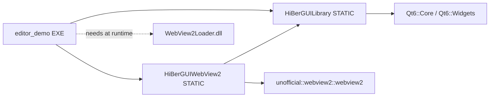

# EditorDemo module

## Overview

`EditorDemo` is the **demo EXE** `editor_demo`: it places the two implementations of the same `ICodeEditor` interface side by side in three tabs - the Qt `CodeEditor`, the WebView2 `WebCodeEditor`, and the merge preview window of both.

Its purpose is to expose rendering quality, performance and size (whether `WebView2Loader` is pulled in) in one place for technology selection and regression checks. It is not part of any product release and `neo_deploy` does not copy it.

## Goals

- **One-screen comparison**: the same JSON/properties samples feed both editors, and language / font size / Tab / theme / read-only / region highlights can all be toggled from buttons;
- **Interface consistency check**: both implementations share `ICodeEditor` and `builtinLanguages()`, so any behavioral divergence is immediately visible;
- **Factory mechanism self-demonstration**: shows how `registerCodeEditorFactory(CodeEditorKind::Web, ...)` + `createCodeEditor(kind, parent)` are wired;
- **Minimal dependencies**: it links only `HiBerGUILibrary`, `HiBerGUIWebView2` and Qt6 Core/Widgets.

## Boundaries

**What it does**

- Three tabs: `Qt editor`, `WebView2 editor`, `merge preview comparison`;
- Per-page buttons: load JSON / load properties, toggle dark/light, read-only/editable, language combo, Tab width (2/4);
- A preset region highlight (`{3, 4, "#2f6b31", "tracked"}`) and one extension action (`fmt`, "indent check") demonstrating `setRegionHighlights` and `addAction`;
- The merge page opens `MergePreviewDialog` for the Qt and Web versions (yellow = fully overwritten lines, green = tracked key-value lines);
- `--web` startup argument: jumps straight to the WebView2 tab, useful for diagnosing a missing runtime.

**What it does not do**

- No real business logic (the sample JSON/properties/merge text are hard-coded constants);
- Not part of product releases or `neo_deploy` deployment;
- Not a test framework: no assertions or automation, evaluation is visual;
- It registers no extension menus or parsers (that is the editor EXE's job).

## Dependencies

| Dependency | Type | Purpose |
|---|---|---|
| `HiBerGUILibrary` | STATIC | `CodeEditor`, `MergePreviewDialog`, `ICodeEditor`, `builtinLanguages` |
| `HiBerGUIWebView2` | STATIC | `WebCodeEditor` / `createWebCodeEditor` |
| `Qt6::Core` / `Qt6::Widgets` | Qt | window, tabs, buttons and status bar |
| `WebView2Loader.dll` | runtime DLL (copied POST_BUILD) | loader for the WebView2 editor |

## Files

| File | Purpose |
|---|---|
| `CMakeLists.txt` | `add_executable(editor_demo src/main.cpp)`; linking and runtime deployment (`WebView2Loader.dll` + `windeployqt`) |
| `src/main.cpp` | all demo code: `DemoWindow` (three tabs), sample texts, merge preview buttons, `--web` argument |

## Build integration

- target: `editor_demo`, an **EXE** (`add_executable(editor_demo src/main.cpp)`, without `WIN32`, so it is a console-subsystem program);
- includes: `src`, `HiBerGUILibrary/include`, `HiBerGUIWebView2/include` (all PRIVATE);
- links (PRIVATE): `HiBerGUILibrary`, `HiBerGUIWebView2`, `Qt6::Core`, `Qt6::Widgets`;
- POST_BUILD (WIN32): copies `WebView2Loader.dll` from `vcpkg_installed/x64-windows[-debug]/bin/` into the output directory and runs `windeployqt` (`--no-translations --no-opengl-sw --no-compiler-runtime --no-system-d3d-compiler`);
- deployment: it is **not** in `neo_deploy`'s `DEPLOY_DEPS`/copy lists, so the artifact stays in the build directory (the `editor_demo` output folder under `build/`).

## Public symbols

This target is a demo EXE with no public headers. Internal usage points worth consulting:

| Symbol | Type | Description |
|---|---|---|
| `DemoWindow` | class (QMainWindow) | three-tab demo window holding `qtEditor_`/`webEditor_` |
| `sampleJson` / `sampleProps` / `sampleMerge` | function | hard-coded sample texts (JSON / server.properties / merge result) |
| `registerCodeEditorFactory(CodeEditorKind::Web, ...)` | call site | demonstrates factory registration (inside `main`) |
| `MergePreviewDialog(CodeEditorKind, parent)` | call site | demonstrates merge preview with both versions |

## Related

- [usage.md](./usage.md)
- [HiBerGUILibrary module](../HiBerGUILibrary/README.md)
- [Editor extensions](../../../extensions/editor/index.md)
