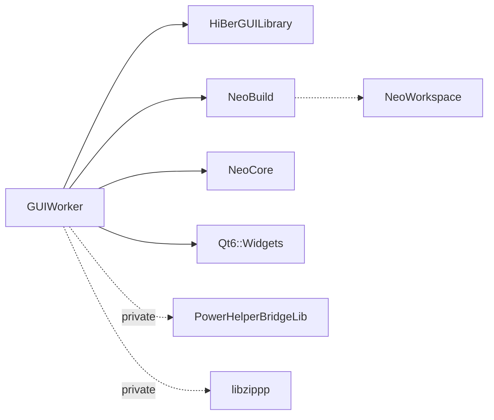

# GUIWorker

## Overview

`GUIWorker` (STATIC, `namespace GUIWorker`) is the domain layer of the GUI. It contains the build wizard and its pages, the build progress UI, the modpack content IDE, the pointer / sync-policy / serverconfig editors and the editor extension registry. Both the main application and `NeoWorkspaceEditor` link it, so a page behaves the same in the wizard and inside the editor.

## Goals

- Separate page logic from engines: a page only collects parameters and displays progress, never performs Git or file work itself;
- Let the main application and the editor share one set of domain widgets instead of duplicating panels;
- Attach config and pointer editors dynamically through a registry, so a new file format ships as a DLL without touching the GUI.

## Boundaries

**What it does**

- `WizardWindow` and its nine pages: repo, branch, modpack, export type, export directory, extra info, build checklist, build, done; plus the flow mode used by `flow gui`;
- `BuildPage` (background build + progress/log UI) with its private `GuiBuildProgress` adapter, and `BuildToolWindow` (command console);
- `RepoEditor`, `BranchEditor`, `ModpackContentIde` (output tree, repo tree, undo/redo, import, file policies);
- `PointerEditorPanel`, `PointerManager`, `ConfigFileEditor`, `SyncPoliciesEditor` / `SyncPoliciesDialog`, `ServerConfigRulesEditor`, `FolderPolicyEditor`, `BatchEditorPanel`, `BatchConvertCard`;
- `EditorExtensionRegistry`: scans `editor/extension`, reads each `*.meta.json`, loads the DLL and exposes config/pointer editors by extension or resolver type;
- `availableCores()` / `CoreInfo`: the server core catalogue used by the branch editor.

**What it does not do**

- Does not perform Git, build, sync or export work - it calls `NeoWorkspace` and `NeoBuild`;
- Does not define the plugin ABI - the interfaces live in `NeoCore`;
- Contains no main-window shell, menu bar or document lifecycle: the main application and the editor each provide their own;
- Does not own the help browser; `PowerHelperBridgeLib` is a private dependency for launching documentation.

## Dependencies

| Dependency | Type | Purpose |
|---|---|---|
| `HiBerGUILibrary` | STATIC, PUBLIC | generic widgets: `OutputTreePanel`, `RepoTreePanel`, `ProgressCard`, `WorkCardStack`, `FileContentEditor`, `GitPanel`, `ToastNotification` |
| `NeoCore` | STATIC, PUBLIC | plugin interfaces, editor extension interfaces, `CancelToken`, `IBuildProgress` |
| `NeoBuild` | STATIC, PUBLIC | build/export engine, exporter registry, UMD preview |
| `Qt6::Core` / `Qt6::Widgets` | library, PUBLIC | widgets, processes, file model |
| `PowerHelperBridgeLib` | STATIC, **PRIVATE** | launching the help documentation |
| `libzippp` / `tomlplusplus` | library, **PRIVATE** | archive inspection and mod metadata inside panels |
| `NeoWorkspace` | STATIC, transitive | reached through `NeoBuild`; the include root is added privately for direct use |

## Files

| File | Purpose |
|---|---|
| `wizard_window.h/.cpp` | wizard, page navigation, clone/sync process driving, progress card |
| `repo_page.*` / `branch_page.*` / `modpack_page.*` | repository, branch and modpack selection |
| `export_type_page.*` / `export_dir_page.*` / `extra_info_page.*` | format, output directory and exporter-specific fields |
| `build_checklist_page.*` | build summary, extra info and U/M/D file tree with collapsible sections |
| `build_page.*` / `build_tool_window.*` | build execution, progress bars, log panel, command console |
| `done_page.*` | completion, warnings and help entry point |
| `modpack_content_ide.*` | content IDE: output/repo trees, undo/redo, import, policy panels |
| `repo_editor.*` / `branch_editor.*` | workspace.json and branch property editors |
| `pointer_editor_panel.*` / `pointer_manager.*` / `batch_convert_card.*` | pointer editing, batch jar-to-pointer conversion |
| `config_file_editor.*` / `sync_policies_editor.*` / `serverconfig_rules_editor.*` / `folder_policy_editor.*` / `batch_editor_panel.*` | sync policy and config editing surfaces |
| `editor_extension_registry.*` | extension scan, DLL load, config/pointer editor lookup |
| `core_catalog.*` | server core catalogue |

## Build integration

- target: `GUIWorker`, library type **STATIC** (`add_library(GUIWorker STATIC src/wizard_window.cpp ...)`), source list above;
- include directory: `modules/GUIWorker/include` (PUBLIC), `src` and the three engine include roots (PRIVATE);
- links `HiBerGUILibrary`, `NeoCore`, `NeoBuild`, `Qt6::Core` and `Qt6::Widgets` **PUBLIC**, and `PowerHelperBridgeLib`, `libzippp`, `tomlplusplus` **PRIVATE**;
- linked **PRIVATE** by the main executable and by `NeoWorkspaceEditor`; `NeoCLI::dispatchFlow` does not implement `flow gui`, so only the host that also links this library can run the GUI flow;
- `CMAKE_AUTOMOC` is on: adding a `Q_OBJECT` class means adding the header to the target sources, otherwise moc output is missing at link time.

## Public symbols

| Symbol | Type | Description |
|---|---|---|
| `WizardWindow` | `QMainWindow` | build wizard: navigation, clone/sync workers, flow mode |
| `FlowConfig` | struct | `startPage`, `endPage`, `collectOnly`, `prefill` for `flow gui` |
| `BuildPage` | `QWidget` | runs `build_modpack` on a worker thread and renders progress/logs |
| `BuildPage::GuiBuildProgress` | nested class, `NeoCore::IBuildProgress` | private adapter that forwards engine progress to the page |
| `ModpackContentIde` | `QWidget` | content IDE over output/repo trees with policy editors |
| `PointerEditorPanel` | `QWidget` | pointer editor: resolvers, download methods, save, batch conversion |
| `PointerManager` | `QDialog` | pointer file manager dialog |
| `EditorExtensionRegistry` | class | scans `editor/extension`, maps file extension / resolver type to an editor |
| `EditorExtensionInfo` | struct | `name`, `version`, `description`, `dllName`, `kind`, `fileTypes`, `priority` |
| `EditorExtensionKind` | enum class | `Parser`, `Pointer` |
| `RepoEditor` / `BranchEditor` | `QWidget` | `workspace.json` and branch property editors (`loadFromJson` / `saveToJson`, `loadBranches` / `saveBranches`) |
| `SyncPoliciesEditor` / `SyncPoliciesDialog` | `QWidget` / `QDialog` | folder/file policy editing, `load` / `save` |
| `ConfigFileEditor` | `QWidget` | per-file config mode, tracked keys/lines, merge preview |
| `ServerConfigRulesEditor` / `FolderPolicyEditor` / `BatchEditorPanel` | `QWidget` | L3 rules, folder policy, batch policy editing |
| `CoreInfo` | struct | `id`, `name`, `category`, `supportsPlugins`; catalogue via `availableCores()` |
| `BuildToolWindow` | `QWidget` | command console with history and `commandEntered` signal |

## Related

- [usage.md](./usage.md)
- [Editor GUI](../../../pack-author/editor-gui.md)
