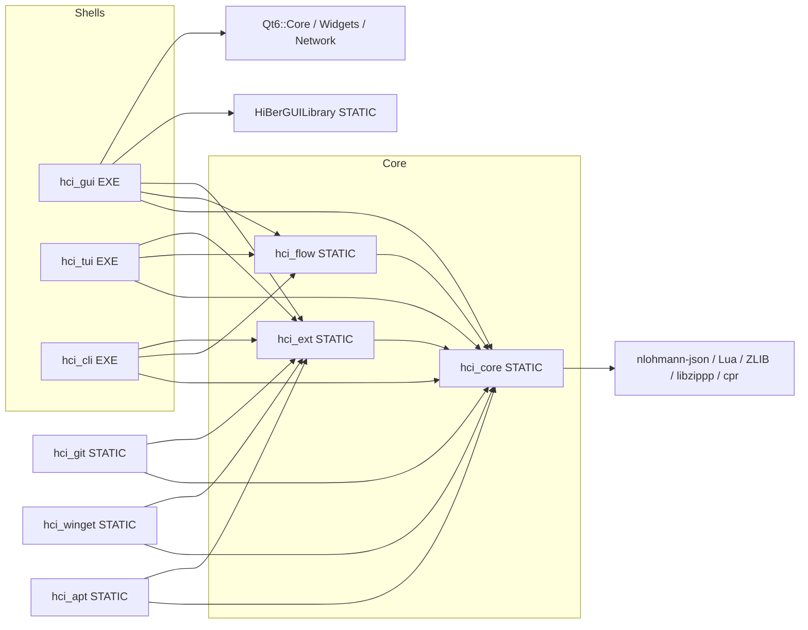

# HiBerCommonInstaller module

## Overview

`HiBerCommonInstaller` (HIC) is the generic installer framework pulled into this repository as a git submodule (`modules/HiBerCommonInstaller`, standalone repository `HiBerCommonInstaller`). It splits "an installer" into a product-agnostic core plus product configuration: the core only understands `product.json` (product metadata), the flow JSON (declarative steps) and the payload (the files to release), so all product differences live in configuration and extensions. The same framework therefore produces NSUM's `NSUM_Installer_<version>.exe` and can be reused by other products as-is.

This page answers one question: which targets HIC consists of, what their boundaries and dependencies are, and how the whole thing is integrated and deployed in the NSUM build.

## Goals

- **Zero-Qt core**: `hci_core` depends only on nlohmann-json, Lua, ZLIB, libzippp and cpr, so one core serves the GUI, TUI and CLI shells as well as the "installer as a library" mode.
- **Declarative flows**: all four flows (install/uninstall/repair/upgrade) are expressed as JSON steps, with conditions and scripts in embedded Lua - changing a flow does not require changing code.
- **Product-agnostic**: product name, components, shortcuts, registry keys, elevation policy and payload rules all come from `product.json`; the framework source never mentions NSUM.
- **Pluggable extensions**: extensions load through static registration, DLL drop-in or a `.hci` package, and can add step types, CLI arguments and download backends.
- **Single-file distribution**: the GUI shell can embed product/flows/deploy entirely through qrc into one EXE.

## Boundaries

**What it does**

- Parses the product configuration (`ProductConfig`) and flow scripts (`FlowSpec` / `FlowStep`) and executes them step by step;
- Provides the built-in steps: `script`, `clean`, `copy`, `extract`, `download`, `run`, `shortcut`, `template`, `registry`;
- Provides the built-in UI steps (rendered by the shell): `language`, `elevate`, `welcome`, `license`, `path`, `git`, `components`, `option`, `confirm`, `input`, `finish`;
- Provides the download backend chain (`direct` / `github` / PowerShell / curl), pluggable backend registration (`winget`, `apt`) and segmented multi-threaded downloads;
- Provides variable interpolation (`Vars`), an event bus (`EventBus`), a service registry (`ServiceRegistry`), logging (`Log` plus multiple sinks), elevation helpers, shortcut/registry writing;
- Provides the three shells `hci_gui` / `hci_tui` / `hci_cli` and the library-mode entry `hci::entry::runInstall`.

**What it does not do**

- It contains no NSUM-specific install logic - NSUM's product/flow/payload and the `--with-editor` argument extension live in the main repository's `nsum_installer/` directory (the framework itself stays product-agnostic);
- It does not build, sync or export Minecraft modpacks (that is `NeoBuild` / `NeoWorkspace`);
- It provides no online update server and does not decide release version numbers (on the NSUM side the root `CMakeLists.txt` `NSUM_INSTALLER_VERSION` is the single source);
- CLI text is not localized (`hci::lang` only translates GUI/TUI shell chrome; CLI output stays English so scripts can parse it).

## Dependencies

| Dependency | Type | Purpose |
|---|---|---|
| `hci_core` | STATIC library (a shared build combines `HCI_CORE_SHARED` with `BUILD_SHARED_LIBS`) | variables, context, flow-independent exec/download/extract/elevation/payload/logging |
| `hci_flow` | STATIC library | `FlowSpec` parsing and `FlowRunner` execution, depends on `hci_core` |
| `hci_ext` | STATIC library | extension host: `IHciExtension`, `HostApi`, `ExtensionLoader`, depends on `hci_core` |
| `hci_git` | STATIC library | generic Git strategy extension `hci.git` (`git_plan` / `git_finalize` / `git_refresh`) |
| `hci_winget` / `hci_apt` | STATIC library | download backend extension `winget` (Windows) / `apt` (POSIX) |
| `nlohmann_json::nlohmann_json` | third-party library | product.json / flow JSON / event payloads |
| `${LUA_LIBRARIES}` | third-party library | `hci::LuaEngine` (`when` conditions and `script` steps) |
| `ZLIB::ZLIB` / `libzippp::libzippp` | third-party library | ZIP extraction (`extract` step, `.hci` extension packages) |
| `cpr::cpr` | third-party library | HTTP downloads (`direct` / `github` backends) |
| `advapi32` / `shell32` / `ole32` | system libraries (WIN32, PRIVATE) | registry writes, shortcuts, UAC elevation |
| `Qt6::Core` / `Qt6::Widgets` / `Qt6::Network` | Qt (`hci_gui` only) | GUI shell and qrc resources |
| `HiBerGUILibrary` | STATIC (`hci_gui` only) | general widgets used by the GUI shell (progress, cards, editors) |

## Files

| File | Purpose |
|---|---|
| `CMakeLists.txt` | version single point (`HCI_VERSION`), build options, `hci_add_version_info`, subdirectory assembly |
| `core/include/hci/{vars,context,bus,log,port,exec,payload,product,script,download,download_http,elevation,lang,entry,extension_registry}.h` | zero-Qt core public headers |
| `core/src/script_lua.cpp` | Lua 5.4 script engine (`hci::LuaEngine`) |
| `flow/include/hci/flow.h` | `FlowSpec` / `FlowStep` / `IFlowUi` / `FlowRunner` |
| `flow/src/flow.cpp` | step execution, `when` evaluation, UI step dispatch, external download mode |
| `ext/include/hci/extension.h` | `IHciExtension` / `HostApi` / `HciCapabilities` / `ExtensionLoader` / `HCI_REGISTER_EXTENSION` |
| `ext/src/extension_loader.cpp` | static registration, DLL drop-in and `.hci` package (ZIP + sha256) loading |
| `ext/git/src/git_ext.cpp` | `hci.git` extension: system/bundled/system-install Git strategies and four-layout probing |
| `ext/winget/src/winget_ext.cpp`, `ext/apt/src/apt_ext.cpp` | download backend extensions |
| `cli/src/main.cpp` | `hci_cli` shell: argument parsing, `CliUi`, JSON protocol blocks, external download mode |
| `gui/src/{main,gui_shell,pages,qrc_source,resource_utils}.cpp` | `hci_gui` shell: flow pages, qrc resource reading, single-file distribution |
| `tui/src/{main,tui_shell}.cpp` | `hci_tui` shell: ANSI text interface |
| `docs/*.md` | the framework's own build-guide / core-api / flow-script / product-config / extension-dev / shell-* documents |
| `resources/installer.ico` | default shell EXE icon (overridable with `HCI_ICON_PATH`) |
| `examples/` | example products (built when `HCI_BUILD_EXAMPLES=ON`) |
| `HiBerGUILibCPP/` | the `HiBerGUILibrary` submodule used by the GUI shell (skipped when the host already provides the target) |

## Build integration

**Targets and library types (`modules/HiBerCommonInstaller/CMakeLists.txt` and its subdirectories)**

| target | Type | Artifact |
|---|---|---|
| `hci_core` | library (STATIC by default; `HCI_CORE_SHARED=ON` adds `WINDOWS_EXPORT_ALL_SYMBOLS`, while a real shared build also needs `BUILD_SHARED_LIBS=ON`) | `hci_core.lib` / `hci_core.dll` |
| `hci_flow`, `hci_ext`, `hci_git`, `hci_winget`, `hci_apt` | STATIC libraries | `.lib` files, not deployed separately |
| `hci_cli` | EXE (console subsystem) | `hci_cli.exe` |
| `hci_gui` | EXE (`qt_add_executable`, deliberately using the console-subsystem entry model - the entry point keeps/releases the terminal itself) | `HCInstaller_Template_<HCI_VERSION>.exe` by default, overridable with `HCI_GUI_OUTPUT_NAME` |
| `hci_tui` | EXE (zero Qt) | `hci_tui.exe` |

**Build options**: `HCI_BUILD_CLI` (default ON), `HCI_BUILD_GUI` (default OFF), `HCI_BUILD_TUI` (default OFF), `HCI_BUILD_EXAMPLES` (default ON), `HCI_CORE_SHARED` (default OFF).

**Version and resources**: `HCI_VERSION` defaults to `PROJECT_VERSION` and a host may override it before `add_subdirectory`; `hci_add_version_info(<target> <desc> <product>)` generates VERSIONINFO (including the `HCI_ICON_PATH` icon block, and `/utf-8` is added for MSVC).

**NSUM-side integration (the `INSTALLER_ONLY_BUILD` branch of the root `CMakeLists.txt`)**

1. `NSUM_INSTALLER_VERSION` -> `HCI_VERSION` and `HCI_GUI_OUTPUT_NAME=NSUM_Installer_${NSUM_INSTALLER_VERSION}`, so the artifact is `NSUM_Installer_1.0.0.exe`;
2. `configure_file(nsum_installer/product.json @ONLY)` injects the version, then together with the four flows, `LICENSE.txt` and the whole `build/deploy` tree (skipping `*.dmp` and `config/custom/*`) it forms `HCI_PRODUCT_FILES`, which the `hci_gui` qrc embeds;
3. after `add_subdirectory(modules/HiBerCommonInstaller)`, `nsum_installer/ext/nsum_args_ext.cpp`, `ext/git/src/git_ext.cpp` and `ext/winget/src/winget_ext.cpp` are **statically registered** into `hci_gui` with `target_sources` (no `extensions/` directory, no extension DLL); `hci_cli` also builds in the git/winget extensions, otherwise the flow reports `unknown step type: git_plan`;
4. the `installer-static` preset (`build_nsum_installer`, static Qt + `x64-windows-static` + `/MT`) produces a single-file installer without runtime DLLs;
5. release targets: `hci_gui_release_to_root` copies `hci_gui.exe` to the build directory root; `hci_cli_dist` assembles `nsum_cli_dist/` (`hci_cli.exe` + `product.json` + `install_cli.json` renamed to `install.json` + `LICENSE.txt` + `deploy/`) so the bridge can install the Runtime unattended. The installer configure must pass `-DHCI_BUILD_CLI=ON` (as the existing `build_nsum_installer` cache does): the `target_sources(hci_cli ...)` call in step 3 is unconditional, so configuring with the CLI shell disabled has no `hci_cli` target to attach sources to.

## Public symbols

| Symbol | Type | Description |
|---|---|---|
| `hci::entry::EntryOptions` | struct | shell-agnostic entry options (mode/productJson/flow/silent/jsonOut/installPath/language/extensionArgs) |
| `hci::entry::runInstall` | function | library mode: run a full install flow and return the process exit code |
| `hci::entry::renderBanner` | function | product-name ASCII banner plus the mandatory powered-by line |
| `hci::ProductConfig` | class | product.json model (components/shortcuts/install.conf/flows/payload/elevation/extension config) |
| `hci::Vars` | class | variable table and recursive `{name}` interpolation |
| `hci::InstallContext` | class | variables, cancel flag, failure policy and free-form state carried by one run |
| `hci::EventBus` / `hci::ServiceRegistry` | class | topic publish/subscribe (sync/queued) and type-erased service lookup |
| `hci::FlowSpec` / `hci::FlowStep` | struct | flow definition and a single step (id/type/ui/next/when/onFail/params) |
| `hci::IFlowUi` | interface | shell UI provider (welcome/license/path/components/git/progress/finish...) |
| `hci::FlowRunner` | class | executes a flow; `setExternalDownload` enables external download mode |
| `hci::IScriptEngine` / `hci::LuaEngine` | interface / class | script engine abstraction and the Lua 5.4 implementation |
| `hci::Log` / `hci::ILogSink` | class / interface | thread-safe multi-sink logging facade and the sink interface |
| `hci::exec::*` | functions | mkdirs/copyTree/cleanDir/extractZip/runProcess/downloadFile/shortcuts/registry |
| `hci::download::IDownloadBackend` | interface | pluggable download backend; `runChain` picks the first working backend |
| `hci::IHciExtension` / `hci::HostApi` | interface / class | extension interface and host API (bus/services/context/product/registry/log) |
| `hci::ExtensionRegistry` | class | three registries: step types, CLI arguments, download backends |
| `hci::ExtensionLoader` | class | `loadStatic` / `loadDirectory` load paths |
| `HCI_REGISTER_EXTENSION` | macro | link-time static extension registration |

## Related

- [usage.md](./usage.md)
- [ADR 0004 - HIC declarative install flow](../../adr/0004-hic-flow.md)
- [Installer (HIC) overview](../../../extensions/installer/index.md)
- [Installer CLI](../../../extensions/installer/cli.md)
- [External download mode](../../../extensions/installer/external-download.md)
