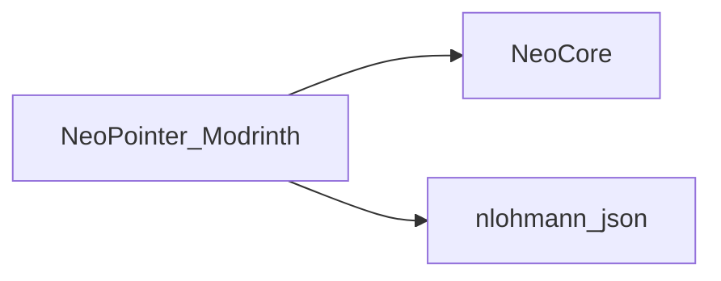

# NeoPointer_Modrinth

## Overview

`NeoPointer_Modrinth` is a runtime pointer resolver plugin (SHARED) implementing `NeoCore::IPluginPointer` to resolve project/version through the Modrinth API.

## Goals

- Resolve pointer metadata into a download URL;
- Pair with the editor extension (no hand-written JSON);
- Depend only on NeoCore interfaces.

## Boundaries

**Does**: can_handle, resolve URL, validate downloads.
**Does not**: cache management (PointerDownloader) or UI.

## Dependencies

## Files

| File | Purpose |
|---|---|
| `src/` | Implementation and `CreatePointer` |
| `NeoPointer_Modrinth.meta.json` | Capability declaration |
| `CMakeLists.txt` | SHARED target |

## Build integration

- target `NeoPointer_Modrinth` (SHARED);
- copied to `pointers/`;
- exports `CreatePointer`.

## Public symbols

| Symbol | Description |
|---|---|
| `CreatePointer` | Factory (`__declspec(dllexport)`) |
| `IPluginPointer` impl | name/can_handle/resolve_url/validate |

## Related

- [usage.md](./usage.md)
- [Pointer docs](../../../extensions/pointers/index.md)