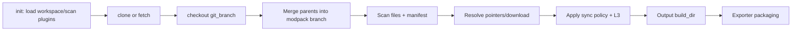

# Build Pipeline

`NeoBuild::BuildEngine` builds a repository into an output directory; exporters then package it.

## Steps

| Step | Entry | Description |
|---|---|---|
| init | `BuildEngine::init` | Load workspace, exporters, parsers, pointer resolvers |
| clone/fetch | `stepCloneOrFetch` | Skips fetch when the local repo has no remote |
| checkout | GitOperations | Uses `git_branch`, not the modpack branch |
| merge | `BranchMerger` | Merges the parent chain; child overrides; handles delete/override |
| scan | File scanning | Builds manifest and hashes |
| pointer | `PointerDownloader` | Resolves/downloads missing files, reuses cache |
| sync policy | `SyncPolicyExecutor` | mirror/incremental/skip/partial |
| export | `IModpackExporter` | nsum/mcbbs/modrinth/hmcl |

## Branches

- **Checkout uses the Git branch** (e.g. `main`);
- **Merge uses the modpack branch** (e.g. `base`/`client`);
- Mixing them causes `pathspec ... did not match`.

## Output directories

- GUI preview: `%TEMP%/NSUM-virtual-build/<branch>/`;
- Real build: the user-selected export/instance directory;
- Release build: build output under `build/` passed to the exporter.

## Failure modes

| Symptom | Cause | Fix |
|---|---|---|
| Checkout failed | Git branch missing/confused | Check `--git-branch` |
| Pointer resolution failed | Resolver missing/dead URL | Check `pointers/` and pointer content |
| Export failed | Invalid extension/fields | Check exporter meta/args |
| Files deleted | mirror policy | Check protect list/policy |

## Related

- [Sync engine](./sync-engine.md)
- [Pointer system](./pointer-system.md)
