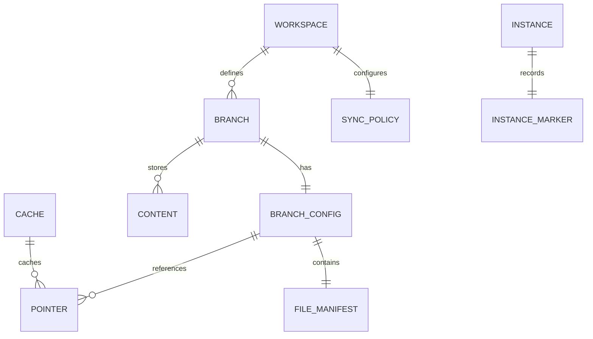
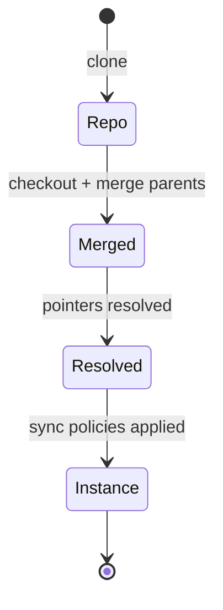

# Data Model

## Entity relationships



## workspace.json

Workspace-level config: workspace (mc/modloader), git (remote/default_branch), branches[], sync_policies, export.metadata.

- `branches[].parent` forms an inheritance chain (cycles rejected);
- `branches[].type` decides client/server use;
- Branch-level policies can override workspace policies.

## branch_config/<branch>.json

| Section | Structure | Purpose |
|---|---|---|
| `file_manifest` | `{relPath: sha256}` | File → content hash |
| `pointer_files` | `{sha256: {resolver, metadata}}` | Hash → download method |
| `serverconfig_sync` | `{enabled, scan_paths, rules}` | L3 save config |
| `custom_mods` | `{enabled, path, merge_order}` | External mod directory |

## Pointers

- Name: `branch_config/<sha256>.pointer`;
- Content: resolver + metadata (+ size/sha256);
- Target path is recorded in `file_manifest` (the pointer has no path).

## Caches

```text
.minecraft/versions/.cache/<sha256>        # build side
.hmcl/nsum/cache/files/<sha256>            # bridge embedded files
```

- Key = content SHA-256;
- Recompute the hash before use (zero trust);
- Caches survive instance deletion and are shared across instances.

## Instance marker

`<instance>/.NSUM/instance.json`:

| Field | Description |
|---|---|
| `repo` / `branch` / `gitBranch` | Repository and branches |
| `packFormat` / `sourceCommit` / `sourceGitBranch` / `defaultBranch` | Provenance |
| `branchType` | Client/server |
| `launchOnSyncFailure` | Whether to launch on failure |

## Lifecycle



## Consistency rules

- `file_manifest` hashes must match pointer/file content;
- Parent chains must be acyclic;
- Every hash in `pointer_files` must have a `.pointer` file (missing ones are reported at build time);
- The instance marker's `repo` must be the user-visible URL, not a local cache path.

## Related

- [Build pipeline](./build-pipeline.md)
- [Sync engine](./sync-engine.md)
