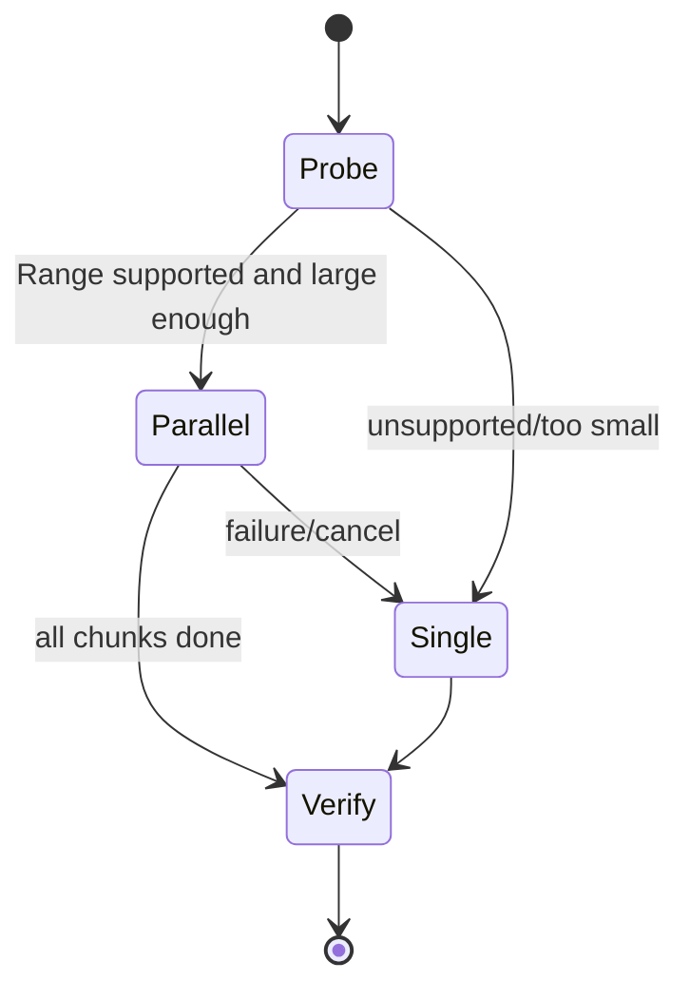

# Downloader

## Probing

- HEAD probe for `Content-Length`/`Accept-Ranges`;
- On HEAD failure (some CDNs/proxies), fall back to `GET Range: bytes=0-0` + `Content-Range`;
- Chunking only when Range is supported and the file is large enough.

## Chunking

- Slices by `threads`, `QFile::resize` preallocates, writes at offsets;
- At most 32 connections per server (process-wide);
- Any chunk failure/cancel: delete the target and fail.

## Fallback

`PointerDownloader::downloadToPath` tries parallel first, then QNAM single-stream.

## Configuration

| Environment variable | Default | Description |
|---|---|---|
| `NSUM_DOWNLOAD_THREADS` | 16 | Chunk count (1–16) |
| `NSUM_DOWNLOAD_MIN_SIZE_MB` | 8 | Smaller files use single stream |
| `NSUM_DOWNLOAD_CHUNK_MB` | 0 | 0 = auto |
| `NSUM_DOWNLOAD_RETRIES` | 2 | Retries |
| `NSUM_DOWNLOAD_PARALLEL` | 1 | 0 disables parallel |

## Proxies/restricted networks

- Parallel downloads may stall at 0 bytes through some proxies → timeouts and fallback are mandatory;
- Chain: parallel → single stream → caller fallback (curl/PowerShell);
- Logs record each chunk range and failure reason.

## Related

- [Pointer system](./pointer-system.md)
- [bridge downloads](../../extensions/client-bridge/download.md)
