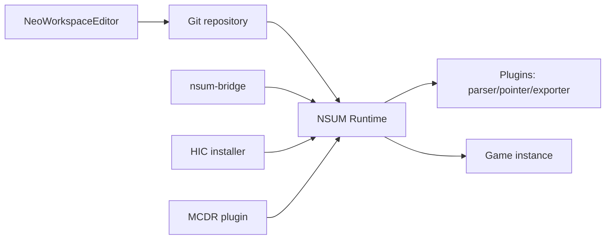

# Architecture

This group explains **why NSUM is designed this way**, how data flows, and what happens on failure. Everything is grounded in the current source (Runtime 1.0.5 / internal 0.1.11).

## Reading order

1. [Overview](./overview.md): components, process boundaries, data flow;
2. [Design goals](./design-goals.md): constraints, tradeoffs, non-goals;
3. [Data model](./data-model.md): workspace / branch / manifest / pointer / cache;
4. [Build pipeline](./build-pipeline.md);
5. [Sync engine](./sync-engine.md): L1/L2/L3;
6. [Pointer system](./pointer-system.md);
7. [Downloader](./downloader.md);
8. [Security](./security.md).

## One-page view

| Layer | Components | Responsibility |
|---|---|---|
| Entry | CLI / GUI / bridge / installer / MCDR | Trigger build/sync |
| Engine | NeoWorkspace + NeoBuild | Repository, branches, merge, sync, export |
| Extensions | parser/pointer/exporter DLLs | Config merge, download resolution, format export |
| Data | Repository + cache + instance | Source of truth and derived outputs |

## Keywords

- **Repository as source of truth**: auditable and revertible;
- **Content addressing**: large files referenced by SHA-256, deduplicated;
- **Zero-trust cache**: re-verify before every use;
- **Manifest-only distribution**: `.nsumpack` carries an index, not the files;
- **Explicit failure**: sync failure aborts launch.

## Diagram sources

- [Mermaid sources and SVG exports](../../../assets/diagrams/README.md)
