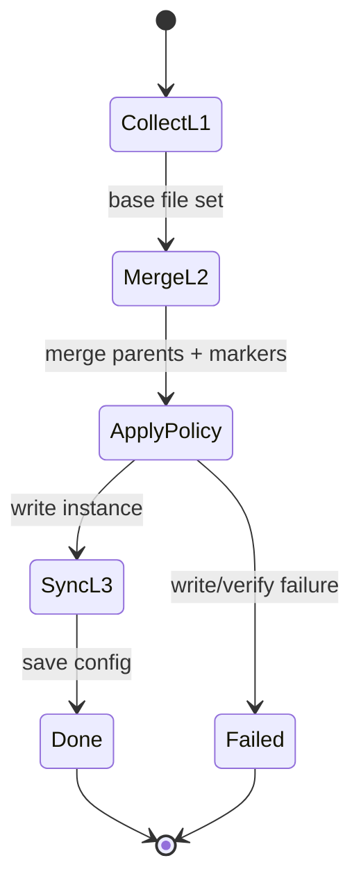

# Sync Engine

## Three tiers

| Tier | Source | Target | Description |
|---|---|---|---|
| L1 | Base branch (base) | Instance | Shared content |
| L2 | Modpack branch (with parents) | Instance | Overrides and final output |
| L3 | Save-level serverconfig | `saves/<save>/serverconfig` | Per-save config |

## State machine

## Policy execution

| Policy | Behavior |
|---|---|
| `skip` | Do not write |
| `mirror` | Wipe and rewrite + delete extras (subject to protection list) |
| `incremental_add` | Add missing only |
| `incremental_overwrite` | Add missing + overwrite existing |
| `default` | Use parent/workspace default |
| `partial` (file) | Merge via parser using tracked_keys/tracked_lines |

## File markers

- `delete`: remove the parent file during merge;
- `override`: force overwrite;
- Markers are stored in branch manifests and versioned with the repo.

## Deletion protection

Before `mirror` deletes extras:

- Root-level `options.txt`, `log4j2.xml`, `natives*`, root `*.jar`;
- `saves/`;
- Explicit policy paths;
- Instance markers (`.NSUM/`, `<id>.json`, `icon.*`).

## L3 serverconfig

- Repository path `branches/<branch>/save/[save]/serverconfig/`;
- `.rule/globle.json` sets the default mode, `.rule/list.json` lists files;
- Synced to `<instance>/saves/<save>/serverconfig/`.

## Failure modes

| Symptom | Cause | Fix |
|---|---|---|
| All files gone after sync | mirror + wrong path/empty target | Check UTF-8 paths and target |
| Player config overwritten | Wrong full/partial policy | Use partial + tracked_keys |
| L3 not applied | Save name/path mismatch | Check `[save]` and `.rule` |

## Related

- [Data model](./data-model.md)
- [Sync rules (author)](../../pack-author/sync-rules.md)
