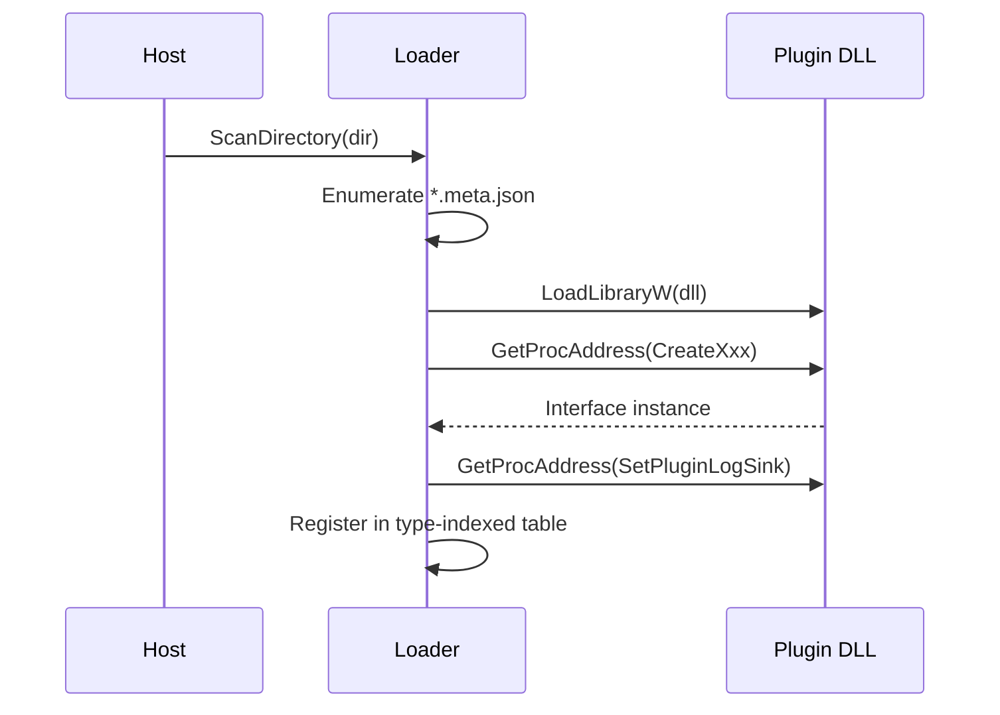

# Extension Registry

NSUM has no single global extension registry; each plugin type has its own scan/load point.

## Load points

| Type | Loader | Directory | Selection |
|---|---|---|---|
| Config parser | `NeoCore::PluginLoader` | `parsers/` | Extension + `priority` |
| Pointer resolver | `NeoBuild::PointerDownloader` | `pointers/` | `resolver` name |
| Exporter | `NeoBuild::ModpackExporter` | `exporters/` | `format` name |
| Editor config extension | Editor registry | `editor/extension/parsers/` | Extension |
| Editor pointer extension | Editor registry | `editor/extension/pointers/` | Resolver name |
| HIC extension | `hci::ExtensionLoader` | Installer extension dir | Registered steps/services |

## Loading sequence

## Naming conventions

- Plugin DLL: `<Type>_<Name>.dll`;
- Meta: same base `*.meta.json` (strip `.meta.json`, append `.dll`);
- Factories: `CreateParser` / `CreatePointer` / `CreateExporter` / `CreateConfigEditor` / `CreateEditorExtension`.

## Failures and isolation

| Case | Behavior |
|---|---|
| DLL missing | Skipped, logs `DLL missing` |
| Factory export missing | Skipped (`CreateXxx not found`) |
| Invalid meta | Plugin skipped |
| Plugin crash | No isolation (same process); fix the plugin |

## Lifecycle

- Scanned once at host initialization; plugin objects owned by the host;
- Plugins must not use host callbacks after their DLL is unloaded;
- Updating plugins requires restarting the host.

## Related

- [Plugin contracts](./plugin-contracts.md)
- [ABI](./abi.md)
