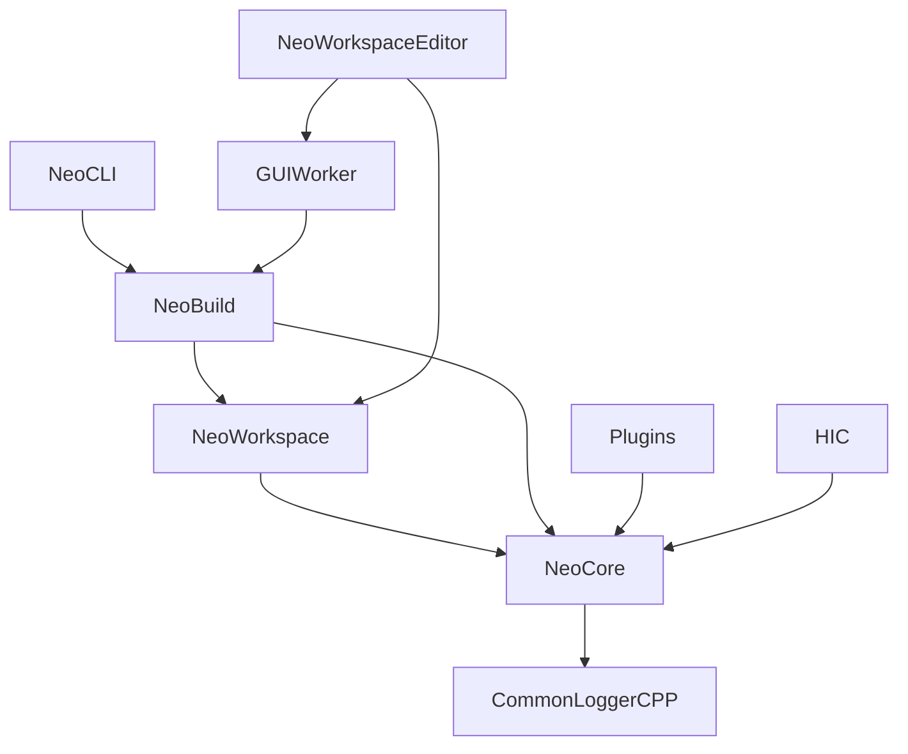

# Module Layout

## Types

| Type | Examples | CMake |
|---|---|---|
| Foundation libraries (STATIC) | NeoCore/NeoWorkspace/NeoBuild/CommonLoggerCPP | `add_library(... STATIC)` |
| Plugins (SHARED) | NeoParser_*/NeoPointer_*/NeoExporter_* | `add_library(... SHARED)` |
| Executables | main program, NeoWorkspaceEditor, PowerHelper | `add_executable` |
| Installer | HIC three shells | `add_executable` |

## Dependency direction

- Dependencies point **downward** only;
- Plugins never link the engine or main program;
- GUI does not call Git/network directly (goes through the domain layer).

## Artifacts

| Artifact | Location |
|---|---|
| `NeoServerUpdateModpack.exe` | `build/deploy/` |
| Plugin DLLs + meta | `build/deploy/{parsers,pointers,exporters}/` |
| Editor extensions | `build/deploy/editor/extension/` |
| Docs | `build/deploy/docs/{zh,en}/` |
| Installer | `build_nsum_installer/NSUM_Installer_<version>.exe` |

## Version injection

The root `CMakeLists.txt` reads `version.json` and defines:

- `NSUM_EXTERNAL_VERSION`
- `NSUM_INTERNAL_VERSION`
- `NSUM_FULL_VERSION`
- `NSUM_GIT_COMMIT`

All targets share these; reconfigure (and clean if needed) after changes.

## Shared header rules

- After changing a header included by multiple targets (members/interfaces), rebuild every target that uses it;
- Layout mismatches typically show up as `HEAP CORRUPTION 0xC0000374` on exit or random `0xC0000005`;
- Do not trust "no work to do"; check .obj timestamps.

## Related

- [ABI](./abi.md)
- [Testing](../testing.md)
