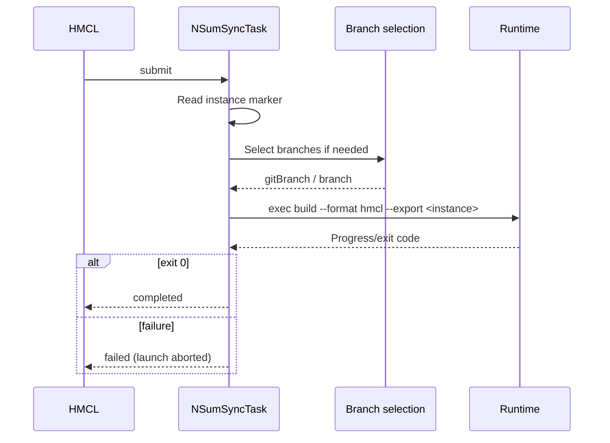

# Bridge Task Chain

## Injection point

bridge wraps HMCL's launch check via Mixin:

```text
LauncherHelper.checkGameState(HMCLGameRepository, GameSettings.Effective, Version)
```

It returns a new chain:

```text
NSumSyncTask("NSUM update check") → original checkGameState result
```

So the NSUM sync is the **first step** of launch and aborts on failure.

## Task chain



## Progress UI

- The sync task appears in the HMCL task dialog;
- The bridge panel mounts at the top of `task-executor-dialog-layout` (not a separate window);
- The panel caches the last status so pre-mount status is not lost;
- Cancel interrupts the Runtime process.

## Cancellation

- HMCL cancellation interrupts the task thread;
- bridge calls `destroyForcibly()` on the Runtime process after `Task.isCancelled()`;
- The game is not launched after cancellation.

## Failure handling

| Case | Behavior |
|---|---|
| Runtime non-zero exit | Task fails, launch aborts |
| Download/sync exception | Error summary and logs |
| `launchOnSyncFailure=true` | Launch with stale content |

## Notes

- A failed injection (Mixin version mismatch) leaves the NSUM page working but skips the launch check;
- The sync must not block the HMCL UI thread;
- Task failure must never be silent.

## Related

- [Usage](./usage.md)
- [Sync and launch](../../user/sync-and-launch.md)
