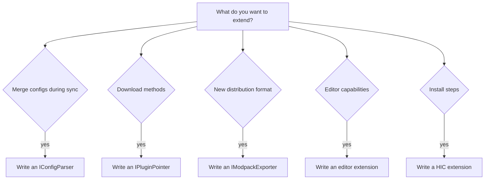

# Extensions

NSUM's core is "repository + sync + launch"; everything else is an extension. This section groups them.

## Groups

| Group | Content | Runs in |
|---|---|---|
| [Parsers](./parsers/index.md) | JSON/YAML/TOML/SNBT/TXT/Properties | Runtime sync |
| [Pointer resolvers](./pointers/index.md) | DirectURL/Modrinth | Runtime downloads |
| [Exporters](./exporters/index.md) | MCBBS/Modrinth/HMCL/NSUM | Build/export |
| [Editor extensions](./editor/index.md) | Config/pointer editor extensions | NeoWorkspaceEditor |
| [Installer](./installer/index.md) | HIC shells and git/winget/apt extensions | Installer |
| [Client bridge](./client-bridge/index.md) | HMCL integration, launch injection, downloads | HMCL |
| [Server plugin](./server-plugin/index.md) | MCDR core install/sync/config | Server |
| [Libraries](./libraries/index.md) | CrashTracker/PowerHelper/GUI/ignore markup | Shared |
| [MCLHR](./mclhr.md) | mod store and hard-link projection | Runtime + bridge |

## Choosing what to extend

## Load directories

| Extension | Directory |
|---|---|
| Parsers/pointers/exporters | `<runtime>/parsers`, `pointers`, `exporters` |
| Editor extensions | `<runtime>/editor/extension/{parsers,pointers}` |
| HIC extensions | Installer extensions directory |
| bridge | HMCL `mods/` |
| MCDR plugin | Server `plugins/` |

## Related

- [Plugin contracts](../developer/framework/plugin-contracts.md)
- [Module reference](../developer/Modules/_meta.json)
