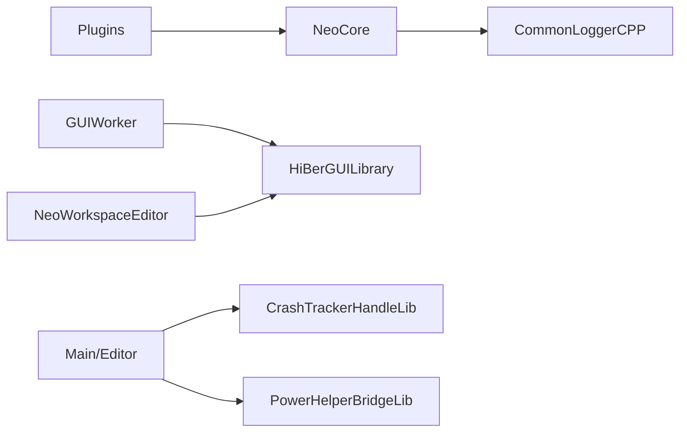

# Libraries

These libraries are not NSUM business logic but are reused by the main program, editor and installer; each lives in its own repository.

| Library | Purpose | Form |
|---|---|---|
| CrashTracker | Crash capture and offline analysis | EXE + static lib |
| PowerHelper | Markdown reader (WebView2) | DLL + EXE |
| HiBerGUILibrary | Generic Qt widgets (trees, progress, Git panel) | STATIC |
| GitIgnoreMarkup | `.gitignore` marked blocks + editor GUI | STATIC + GUI |

## Dependency direction

## Pages

- [CrashTracker](./crashtracker.md)
- [PowerHelper](./powerhelper.md)
- [HiBerGUILibrary](./guibergui.md)
- [GitIgnoreMarkup](./gitignore-markup.md)
